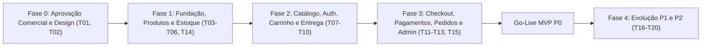

# 00 — Governança, Roadmap e Backlog Priorizado

Este documento define a estratégia de execução, a sequência técnica recomendada, o roadmap faseado, o backlog completo (`T01`–`T20`) com Histórias de Usuário, os critérios de pronto (DoR/DoD), o orçamento de horas e o registro de riscos do e-commerce de roupas e acessórios.

---

## 1. Princípios de Engenharia e Sequência Segura

O módulo central de um e-commerce de vestuário é a combinação entre **produtos, variações e estoque**. Modelar checkout ou carrinho antes de estabilizar a estrutura de variantes gera retrabalho em cadeia em todo o sistema.

Por isso, o projeto adota obrigatoriamente a **Sequência Segura de Implementação**:

**Produtos → Variações → Estoque → Catálogo → Carrinho → Pedidos → Pagamentos → Entrega**

### Diretrizes Não Negociáveis
1. **Unificação simples + variável (*Default Variant*):** Todo produto possui ao menos uma `ProductVariant` (produtos simples usam variante padrão oculta). Carrinho, reserva, pedido e movimentação de estoque nunca bifurcam por tipo de produto.
2. **Regras comerciais sem hardcode:** Como os 12 itens comerciais da Seção 8 da v1.0 ainda aguardam aprovação formal do lojista ([01-APROVACAO-COMERCIAL-CLIENTE.md](./01-APROVACAO-COMERCIAL-CLIENTE.md)), todo parâmetro variável (cidade, bairros, taxa, prazo, pedido mínimo, retirada, tempo de reserva Pix/Cartão, limite de imagens e políticas) reside em banco (`StoreConfig`, `DeliveryZone`, `StorePolicy`).
3. **Valores em centavos inteiros:** Todo cálculo monetário ocorre exclusivamente em inteiros (`Int`, centavos de BRL) e é recalculado no servidor.
4. **Escopo controlado no MVP:** Um único lojista, cadastro manual de 50–500 produtos e entrega local. Integrações com ERP, emissão automática de NF-e, marketplace multi-lojista e frete nacional via Correios/Melhor Envio ficam fora do escopo do MVP.

---

## 2. Pipeline de Entrega em Fases

### Gates de Passagem entre Fases

| Fase | Tarefas | Critério de Entrada | Gate de Saída (Obrigatório) |
| --- | --- | --- | --- |
| **Fase 0 — Descoberta & Design** | `T01`, `T02` | Documentação base (`00`–`07`) revisada | Caderno comercial (`docs/01`) assinado ou valores provisórios homologados para staging; Design System e protótipo Figma aprovados. |
| **Fase 1 — Fundação & Núcleo** | `T03`, `T04`, `T05`, `T06`, `T14` | Repositório isolado criado; provedor Postgres provisionado | `schema.prisma` migrado com constraints SQL; cadastro manual de produto simples e variável funcional com SKU único e ajuste atômico de estoque. |
| **Fase 2 — Loja, Conta & Compra** | `T07`, `T08`, `T09`, `T10` | Catálogo com produtos de teste populados (`seed.ts`) | Loja responsiva mobile/desktop, matriz Cor×Tamanho fiel ao estoque, login + merge de carrinho visitante e validação de cobertura local. |
| **Fase 3 — Checkout & Operação** | `T11`, `T12`, `T13`, `T15` | Gate de aprovação comercial (`docs/01`) fechado; conta sandbox do gateway ativa | Reserva temporária + Pix/Cartão + webhooks idempotentes (`CA10`) + gestão de pedidos no Admin + todos os testes `CA01`–`CA24` verdes + teste de restore aprovado. |
| **Fase 4 — Evolução P1 e P2** | `T16`–`T20` | MVP P0 estável em produção (pós-monitoramento 72h) | Entregas incrementais P1 (e-mails ampliados, dashboard, filtros avançados) seguidas por P2 (cupons, favoritos/avaliações). |

> [!IMPORTANT]
> O desenvolvimento das regras de negócio e das telas configuráveis de Checkout e Entrega pode começar em ambiente de desenvolvimento usando valores de referência, porém **nenhum deploy de produção (Go-Live) pode ocorrer antes da assinatura formal de [01-APROVACAO-COMERCIAL-CLIENTE.md](./01-APROVACAO-COMERCIAL-CLIENTE.md)**.

---

## 3. Backlog Priorizado Completo (`T01`–`T20`)

Critérios de prioridade herdados da v1.0:
- **P0:** Indispensável para a operação inicial (MVP).
- **P1:** Importante para completar a experiência operacional e comercial.
- **P2:** Melhoria futura pós-estabilização.

| ID | Módulo | Pri. | Dependências | História de Usuário (User Story) | Entregáveis Técnicos | CAs Relacionados |
| --- | --- | --- | --- | --- | --- | --- |
| **T01** | Planejamento | **P0** | — | Como lojista e equipe técnica, queremos formalizar as 12 decisões comerciais e regras de entrega antes do checkout para evitar retrabalho em produção. | Caderno comercial aprovado ([docs/01](./01-APROVACAO-COMERCIAL-CLIENTE.md)), tabela inicial de `DeliveryZone` e `StorePolicy` redigidas. | `CA12`, `CA16` |
| **T02** | Design | **P0** | `T01` (parcial: posicionamento) | Como cliente da loja, quero uma interface moderna, legível e responsiva no celular para navegar e comprar roupas com confiança. | Identidade visual, tokens CSS/Tailwind no sistema agnóstico ([docs/06](./06-UX-ARQUITETURA-INFORMACAO-E-DESIGN.md)), protótipo Figma (Home, PLP, PDP, Carrinho, Checkout, Conta, Admin). | `CA15` |
| **T03** | Fundação | **P0** | — | Como desenvolvedor, quero o repositório Next.js + TypeScript configurado com lint, formatação e CI para garantir qualidade contínua desde o dia 1. | `git init` dedicado, Next.js App Router, TS strict, Tailwind CSS, ESLint/Prettier, Vitest, GitHub Actions CI, `.env.example`. | `CA15` |
| **T04** | Fundação | **P0** | `T03` | Como desenvolvedor, quero o PostgreSQL e o Prisma configurados com constraints e seed para persistir os dados com integridade referencial. | `prisma/schema.prisma` (23 modelos), migration inicial + constraints SQL `CHECK`, `prisma/seed.ts`, client singleton. | `CA11`, `CA16` |
| **T05** | Produtos | **P0** | `T04` | Como sistema, preciso modelar produtos simples, opções dinâmicas e combinações de variantes com SKU próprio para suportar qualquer grade de vestuário. | Domínios `Catalog` e `Variants`, gerador determinístico de `optionCombinationKey`, estratégia *Default Variant*, validação de SKU único. | `RN01`–`RN05`, `RN20`–`RN21` |
| **T06** | Administração | **P0** | `T02`, `T05` | Como administrador, quero cadastrar e editar categorias, produtos simples/variáveis, imagens e preços manualmente em um painel próprio. | CRUD `/admin/categorias`, `/admin/produtos`, upload assinado Cloudinary, gerador de grade Cor×Tamanho, `AuditLog`, revalidação ISR. | `CA01`, `CA02`, `CA20`, `CA22` |
| **T07** | Loja | **P0** | `T02`, `T06` | Como cliente, quero navegar pelo catálogo, buscar por nome, filtrar por categoria/tamanho/cor/preço e escolher variações disponíveis na página do produto. | Home, PLP `/produtos` e `/categoria/[slug]`, busca, ordenação, PDP `/produto/[slug]` com galeria e matriz inteligente Cor×Tamanho. | `CA03`, `CA04`, `CA05`, `CA15` |
| **T08** | Segurança | **P0** | `T04` | Como cliente ou administrador, quero criar conta, fazer login com segurança e acessar apenas os dados permitidos ao meu perfil. | Auth.js/Better Auth, Argon2id/bcrypt, recuperação de senha, middleware RBAC (`CUSTOMER`/`ADMIN`), proteção contra IDOR e rate limit. | `CA14`, `CA23` |
| **T09** | Compra | **P0** | `T05`, `T07`, `T08` | Como cliente, quero adicionar produtos ao carrinho (mesmo antes do login), ajustar quantidades respeitando o estoque e manter os itens ao entrar na conta. | Carrinho persistente (visitante + usuário), drawer + página `/carrinho`, recálculo server-side, detecção de alteração de preço e merge no login. | `CA05`, `CA06`, `CA07`, `CA18` |
| **T10** | Compra | **P0** | `T01`, `T04`, `T08` | Como cliente, quero cadastrar meu endereço, consultar se meu CEP/bairro tem entrega local, ver taxa/prazo ou optar por retirada quando habilitada. | CRUD de `Address`, motor de cotação `DeliveryZone` (CEP/bairro) + retirada, bloqueio claro fora da cobertura, integração opcional ViaCEP. | `CA12` |
| **T11** | Compra | **P0** | `T09`, `T10` | Como cliente, quero finalizar a compra com total transparência de valores e garantia de que os itens fiquem reservados enquanto concluo o pagamento. | Fluxo `/checkout`, `Idempotency-Key`, validação server-side de preços/pedido mínimo/cobertura, criação atômica de `Order` + `StockReservation`. | `CA07`, `CA11`, `CA19`, `CA24` |
| **T12** | Pagamentos | **P0** | `T01`, `T11` | Como cliente, quero pagar via Pix (QR Code/Copia e Cola) ou cartão com processamento seguro e retorno claro de aprovação ou recusa. | Interface `PaymentGatewayPort`, adaptador do gateway escolhido, geração de Pix com expiração, tokenização de cartão (PCI SAQ-A). | `CA08`, `CA09`, `CA21`, `CA24` |
| **T13** | Pedidos | **P0** | `T11`, `T12` | Como sistema e cliente, precisamos confirmar pedidos apenas após validação real do gateway, liberar reservas vencidas e acompanhar cada etapa do pedido. | Endpoint webhook com validação HMAC + `WebhookEvent` idempotente, cron de expiração de reserva, tratamento de *late payment*, `/conta/pedidos`. | `CA08`, `CA10`, `CA14`, `CA16`, `CA17` |
| **T14** | Administração | **P0** | `T04`, `T05` | Como administrador, quero controlar entradas/saídas manuais de estoque com motivo e impedir saldo negativo mesmo sob vendas simultâneas. | Tela `/admin/estoque`, registro obrigatório em `InventoryMovement` + `AuditLog`, transações atômicas `stockOnHand`/`stockReserved`. | `CA03`, `CA11`, `CA20` |
| **T15** | Administração | **P0** | `T13`, `T14` | Como administrador, quero visualizar pedidos, filtrar por status, avançar etapas operacionais e configurar zonas de entrega e políticas da loja. | `/admin/pedidos` e detalhe com máquina de estados, `/admin/entrega`, `/admin/configuracoes` (`StoreConfig` + `StorePolicy`), histórico imutável. | `CA13`, `CA20`, `CA22` |
| **T16** | Integrações | **P1** | `T08`, `T13` | Como cliente, quero receber e-mails claros de boas-vindas, pedido criado/Pix, pagamento aprovado, envio/retirada e entrega concluída. | Resend + React Email templates transacionais, fila/retry leve em falhas não bloqueantes, log de disparo. | — |
| **T17** | Administração | **P1** | `T15` | Como administrador, quero acompanhar faturamento, ticket médio, pedidos por status e itens com estoque baixo em um dashboard operacional. | `/admin` com KPIs agregados, gráfico de vendas por período e alerta de ruptura de estoque configurável. | — |
| **T18** | Loja | **P1** | `T07` | Como cliente, quero combinar múltiplos filtros (vários tamanhos, cores, faixas de preço, apenas disponíveis) com contadores dinâmicos para achar peças rápido. | Query builders otimizados, URL sync com filtros combináveis, facet counts e badges de filtros ativos. | `CA15` |
| **T19** | Marketing | **P2** | `T11`, `T15` | Como administrador, quero criar cupons promocionais com validade, valor mínimo e limite de uso para campanhas sazonais. | Novas entidades `Coupon` / `CouponRedemption`, aplicação server-side no carrinho/checkout, CRUD administrativo. | — |
| **T20** | Experiência | **P2** | `T07`, `T08` | Como cliente autenticado, quero salvar peças favoritas e avaliar produtos comprados para revisitar itens e ajudar outros compradores. | Novas entidades `WishlistItem` e `ProductReview` (somente compra verificada + moderação admin), UI na PDP e `/conta`. | — |

---

## 4. Definition of Ready (DoR) e Definition of Done (DoD)

### Definition of Ready (antes de iniciar qualquer tarefa)
- Regras de negócio (`RN`) e critérios de aceite (`CA`) aplicáveis estão explicitados nos documentos `02`, `04` e `05`.
- Dependências anteriores do grafo (`T01`–`T20`) foram concluídas e mergeadas na branch principal.
- Decisões comerciais bloqueantes da tarefa (quando aplicável, ex.: `T01` antes de `T10`/`T12`) estão formalizadas ou mapeadas para `StoreConfig`.
- Contratos de UI (wireframe/componente) ou de API/Zod estão definidos.

### Definition of Done (para considerar uma tarefa concluída)
- Código implementado em TypeScript estrito (zero `any` injustificado) e seguindo a arquitetura modular ([docs/03](./03-ARQUITETURA-E-SEGURANCA.md)).
- Validação de entrada com Zod e checagem de autorização (`RBAC` / ownership) aplicadas no servidor.
- Migrations Prisma versionadas e testadas em banco PostgreSQL limpo (quando houver mudança de schema).
- Testes unitários e/ou de integração cobrindo os cenários felizes e de falha da tarefa rodando com sucesso no CI.
- Nenhuma regressão de layout mobile/desktop e conformidade básica de acessibilidade (teclado, contraste, foco).
- Ações administrativas relevantes gravando `AuditLog` e erros operacionais registrados em log estruturado sem vazar PII.

---

## 5. Estimativa de Esforço e Planejamento de Execução

Mantendo integralmente a estimativa técnica consolidada na v1.0:

| Etapa | Horas Estimadas | Tarefas Associadas |
| --- | ---: | --- |
| Requisitos e documentação | 20h | `T01`, documentação técnica e homologação |
| Design e prototipação | 30h | `T02` |
| Arquitetura e configuração | 22h | `T03`, setup Vercel/Cloudinary/Resend/Sentry |
| Catálogo e frontend | 65h | `T07`, `T18` (parcial), telas públicas responsivas |
| Backend e banco | 70h | `T04`, `T05`, `T14` (núcleo), APIs e modelagem |
| Autenticação e permissões | 20h | `T08` |
| Carrinho e checkout | 32h | `T09`, `T11` |
| Pagamentos | 25h | `T12`, `T13` (webhooks + adaptador) |
| Entrega local | 12h | `T10` |
| Painel administrativo | 45h | `T06`, `T14` (UI), `T15`, `T17` |
| Testes e correções | 35h | Suíte Vitest + Playwright + concorrência + QA `CA01`–`CA24` |
| Publicação e documentação | 15h | CI/CD, restore drill, Go-Live e runbooks |
| **Total técnico estimado** | **391h** | Escopo base consolidado |

### Reserva de Aprendizagem, Adaptação e Cronograma

- **Reserva técnica recomendada (+15% a +25%):** eleva o planejamento total para **450h a 490h**.
- **Projeção com dedicação de 10–12 horas produtivas/semana:** aproximadamente **38 a 49 semanas** (cerca de 9 a 11 meses corridos), sem contar atrasos externos (aprovação de marca/políticas pelo cliente, homologação de conta PJ em gateway ou emissão de CNPJ).
- **Aceleração possível:** com dedicação de 20–24h/semana ou entrega fatiada (MVP P0 primeiro, estimando ~320–360h com reserva para `T01`–`T15`, e P1/P2 após Go-Live), o lançamento inicial pode ocorrer em **15 a 20 semanas**.

---

## 6. Registro de Riscos e Mitigações

| ID | Risco | Prob. | Impacto | Mitigação Documentada |
| --- | --- | --- | --- | --- |
| **RK01** | Atraso do cliente nas 12 decisões comerciais (frete, troca, reserva) ou identidade visual | Alta | Alto | Caderno pronto em [docs/01](./01-APROVACAO-COMERCIAL-CLIENTE.md); sistema desenhado com `StoreConfig`, `DeliveryZone` e `StorePolicy` 100% dinâmicos + Design System agnóstico ([docs/06](./06-UX-ARQUITETURA-INFORMACAO-E-DESIGN.md)). |
| **RK02** | Compra concorrente do último item ou pagamento Pix após expiração da reserva | Média | Crítico | Baixa/reserva atômica em transação SQL, constraints `CHECK` no PostgreSQL, cron de expiração e fluxo explícito de *late payment* ([docs/05](./05-CONTRATOS-API-E-FLUXOS.md)). |
| **RK03** | Divergência cadastral/homologação de conta PJ no gateway de pagamentos | Média | Alto | Camada `PaymentGatewayPort` desacoplada permite desenvolver sobre sandbox e trocar entre Mercado Pago, Pagar.me ou Asaas sem refatorar pedidos ([docs/03](./03-ARQUITETURA-E-SEGURANCA.md)). |
| **RK04** | Passivo jurídico por ausência de política de arrependimento (7 dias CDC) ou dados obrigatórios (Decreto 7.962/2013) | Média | Alto | Campos obrigatórios de CNPJ, endereço e canal de atendimento em `StoreConfig` + páginas de políticas obrigatórias antes do Go-Live ([docs/01](./01-APROVACAO-COMERCIAL-CLIENTE.md), [docs/03](./03-ARQUITETURA-E-SEGURANCA.md)). |
| **RK05** | Cadastro inconsistente de SKUs ou variantes duplicadas pelo lojista | Alta | Médio | Geração guiada de matriz no Admin + chave determinística `optionCombinationKey` com `@@unique([productId, optionCombinationKey])` ([docs/04](./04-MODELAGEM-DADOS-E-PRISMA.md)). |
