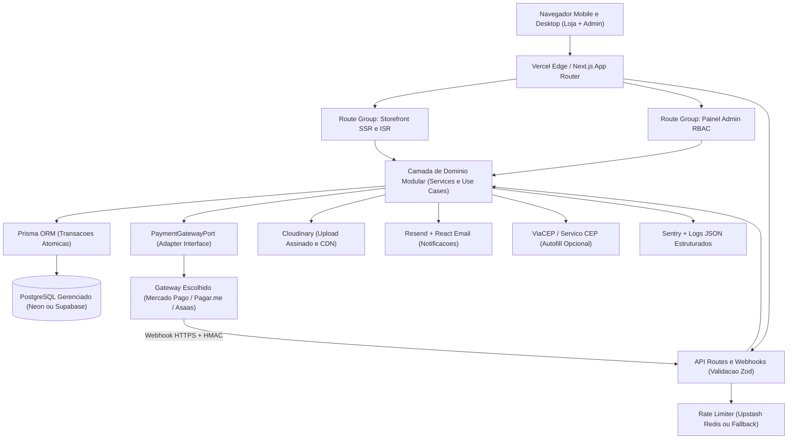

# 03 — Arquitetura da Aplicação, Gateways, Segurança e Conformidade Legal

Este documento detalha a arquitetura de software em monólito modular, a stack de produção recomendada para o Brasil, o padrão adaptador agnóstico de pagamentos (`PaymentGatewayPort`) com comparativo entre gateways, o pipeline de mídia/e-mails, a arquitetura de segurança (OWASP + RBAC + auditoria) e os requisitos de conformidade legal (**LGPD** e **CDC / Decreto nº 7.962/2013**).

---

## 1. Visão Arquitetural

A plataforma adota um **Monólito Modular** em **Next.js (App Router) + TypeScript**, separando claramente interface pública, painel administrativo, rotas API/webhooks e casos de uso de domínio isolados por módulo. Essa abordagem maximiza velocidade de entrega para 1 lojista e 50–500 produtos sem complexidade prematura de microsserviços, mantendo fronteiras limpas caso um módulo precise evoluir no futuro.



---

## 2. Stack Tecnológica Recomendada

| Camada | Tecnologia | Justificativa Técnica e Operacional |
| --- | --- | --- |
| **Framework & Linguagem** | Next.js (App Router) + TypeScript (`strict: true`) | SSR/ISR para SEO do catálogo, Server Components para reduzir JS no mobile e API Routes integradas no mesmo deploy. |
| **Estilização** | Tailwind CSS + CSS Custom Properties | Tokens semânticos fáceis de tematizar quando a identidade visual (`T02`) for definida ([docs/06](./06-UX-ARQUITETURA-INFORMACAO-E-DESIGN.md)). |
| **Hospedagem & Cron** | Vercel | Deploy atômico por PR (Preview), SSL automático, CDN global e Vercel Cron para job de expiração de reservas. |
| **Banco de Dados & ORM** | PostgreSQL (Neon ou Supabase) + Prisma ORM | Suporte robusto a transações ACID, `CHECK` constraints, índices parciais, locks de linha e PITR nativo. |
| **Autenticação** | Auth.js v5 (ou Better Auth) + Argon2id / bcrypt | Controle total sobre sessões em cookies `HttpOnly`, sem dependência cara de terceiros por MAU e integração direta com Prisma. |
| **Validação de Contratos** | Zod | Schema único validando formulários no cliente, payloads em API Routes e variáveis de ambiente no boot. |
| **Pagamentos** | Adaptador `PaymentGatewayPort` | Desacopla regras de checkout/webhook do provedor específico (Pix + Cartão). |
| **Imagens** | Cloudinary | Compressão automática (`f_auto,q_auto`), redimensionamento responsivo e upload direto assinado sem sobrecarregar a Vercel. |
| **E-mail Transacional** | Resend + React Email | Templates versionados em JSX, boa entregabilidade no Brasil via DKIM/SPF e API simples. |
| **Rate Limit (Opcional/Rec.)** | Upstash Redis (`@upstash/ratelimit`) | Limitação distribuída em Serverless para login, reset de senha, checkout e consulta de CEP. |
| **Observabilidade** | Sentry + Logger JSON (`pino`) | Rastreamento de exceções frontend/backend com `requestId` e alertas de webhook/estoque. |
| **Testes** | Vitest + Playwright | Pirâmide completa: unitários, integração transacional contra PostgreSQL real e E2E mobile/desktop. |

---

## 3. Estrutura Modular do Código-Fonte (`T03`)

```text
src/
├── app/
│   ├── (store)/                  # Loja pública (Home, PLP, PDP, Carrinho, Checkout, Conta, Políticas)
│   ├── (admin)/admin/            # Painel administrativo protegido por RBAC ADMIN
│   └── api/
│       ├── auth/                 # Registro, login, recuperação de senha
│       ├── cart/                 # Carrinho e merge visitante -> usuário
│       ├── checkout/             # Criação atômica de pedido + reserva + pagamento
│       ├── delivery/             # Cotação de entrega local e retirada
│       ├── orders/               # Consulta e cancelamento do cliente
│       ├── webhooks/payments/    # Entrada idempotente por provedor [provider]
│       ├── internal/jobs/        # Cron de expiração de reservas e limpeza TTL
│       ├── admin/                # Endpoints administrativos auditados
│       └── health/               # Healthcheck (DB ping)
├── modules/                      # Regras de negócio isoladas por domínio
│   ├── auth/
│   ├── catalog/
│   ├── variants/
│   ├── inventory/
│   ├── cart/
│   ├── checkout/
│   ├── orders/
│   ├── payments/
│   │   ├── ports/payment-gateway.port.ts
│   │   ├── adapters/             # mercadopago.adapter.ts | pagarme.adapter.ts | asaas.adapter.ts
│   │   └── payment-gateway.factory.ts
│   ├── delivery/
│   └── admin/
└── lib/
    ├── db/                       # Prisma Client singleton + helpers de transação
    ├── auth/                     # Helpers de sessão, RBAC e ownership
    ├── cloudinary/               # Geração de assinatura de upload e transformação URL
    ├── email/                    # Cliente Resend e templates React Email
    ├── logger/                   # Logger JSON com redação de PII
    ├── rate-limit/               # Rate limiter por IP/usuário
    └── env.ts                    # Validação Zod das variáveis de ambiente
```

---

## 4. Estratégia de Renderização e Cache (Next.js)

Para unir performance de loja (Core Web Vitals) com precisão absoluta de preço e estoque:

| Área | Estratégia de Renderização | Política de Cache e Revalidação |
| --- | --- | --- |
| **Home, Categorias, PLP e Políticas** | Server Components + cache por tags (`unstable_cache` / `revalidateTag`) | Revalidação sob demanda nas mutações do Admin (`products`, `categories`, `policies`, `store-config`) + fallback periódico de 300s. |
| **PDP (Dados editoriais vs Estoque)** | Shell estático/cacheado + bloco de preço/estoque dinâmico (`no-store` ou fetch client/RSC fresco) | Evita vender peça esgotada por cache stale; mutações de venda/ajuste invalidam `product:${slug}`. |
| **Carrinho, Checkout, Conta e Admin** | Renderização dinâmica pura (`force-dynamic` / `no-store`) | Zero cache compartilhado; dados sempre lidos diretamente do PostgreSQL na sessão autenticada. |

---

## 5. Camada Agnóstica de Pagamentos (`PaymentGatewayPort`)

Como o gateway definitivo ainda será contratado após alinhamento com o cliente (`docs/01`), todo o módulo `Payments` programa contra uma interface única (**Adapter Pattern**), garantindo `RNF12`: trocar entre Mercado Pago, Pagar.me ou Asaas exige apenas configurar o adaptador ativo sem alterar checkout, pedidos ou banco.

### 5.1. Contrato da Interface (`src/modules/payments/ports/payment-gateway.port.ts`)

```typescript
export type SupportedPaymentProvider = "mercadopago" | "pagarme" | "asaas";

export interface CreatePixPaymentInput {
  orderId: string;
  orderNumber: string;
  amountCents: number;
  expiresAt: Date;
  customer: {
    name: string;
    email: string;
    document?: string; // CPF quando exigido pelo gateway
    phone?: string;
  };
  notificationUrl: string;
  idempotencyKey: string;
}

export interface CreateCardPaymentInput {
  orderId: string;
  orderNumber: string;
  amountCents: number;
  installments: number;
  cardToken: string; // Token gerado pelo SDK do gateway no browser (PCI SAQ-A)
  paymentMethodId?: string;
  customer: {
    name: string;
    email: string;
    document?: string;
    phone?: string;
  };
  notificationUrl: string;
  idempotencyKey: string;
}

export interface NormalizedPaymentResult {
  provider: SupportedPaymentProvider;
  externalPaymentId: string;
  status: "PENDING" | "AUTHORIZED" | "PAID" | "FAILED" | "EXPIRED";
  pixQrCodeBase64?: string;
  pixCopyPaste?: string;
  pixExpiresAt?: Date;
  failureCode?: string;
  failureMessage?: string;
  rawMetadata?: Record<string, unknown>;
}

export interface NormalizedWebhookEvent {
  provider: SupportedPaymentProvider;
  externalEventId: string;
  externalPaymentId: string;
  eventType: string;
  statusFromPayload?: string;
  rawPayload: unknown;
}

export interface PaymentGatewayPort {
  readonly provider: SupportedPaymentProvider;
  createPixPayment(input: CreatePixPaymentInput): Promise<NormalizedPaymentResult>;
  createCardPayment(input: CreateCardPaymentInput): Promise<NormalizedPaymentResult>;
  getPaymentStatus(externalPaymentId: string): Promise<NormalizedPaymentResult>;
  refundPayment(externalPaymentId: string, amountCents?: number): Promise<{
    externalRefundId: string;
    status: "REFUNDED" | "PARTIALLY_REFUNDED" | "PENDING";
  }>;
  verifyWebhookSignature(params: {
    rawBody: string;
    headers: Record<string, string | undefined>;
  }): Promise<boolean>;
  parseWebhookEvent(rawBody: string): Promise<NormalizedWebhookEvent>;
}
```

### 5.2. Comparativo Técnico-Financeiro para o Brasil (Pix + Cartão)

| Critério | Mercado Pago | Pagar.me (Stone) | Asaas |
| --- | --- | --- | --- |
| **Pix Dinâmico + Expiração** | Sim (`date_of_expiration` configurável, QR Base64 + Copia e Cola nativos) | Sim (expiração em segundos, QR + código nativos) | Sim (cobrança Pix com QR Base64 + payload + validade) |
| **Cartão Tokenizado (PCI SAQ-A)** | Sim (MercadoPago.js v2 / Payment Brick) | Sim (Pagar.me Tokenizer / Checkout SDK) | Sim (tokenização via API/SDK ou link; atenção ao fluxo transparente) |
| **Parcelamento** | Nativo via API e SDK | Nativo com regras flexíveis de juros | Nativo (a vista ou parcelado) |
| **Estorno via API (Pix e Cartão)** | Sim (total e parcial) | Sim (total e parcial) | Sim (estorno Pix e cartão via API) |
| **Segurança de Webhook** | Assinatura HMAC (`x-signature` + `x-request-id`) + validação S2S obrigatória | Assinatura/autenticação configurável + validação S2S | Token de autenticação no header (`asaas-access-token`) + validação S2S |
| **Experiência Sandbox** | Boa, com usuários de teste e cartões simulados | Muito boa, documentação técnica orientada a devs | Boa, ambiente sandbox dedicado com chaves separadas |
| **Modelo de Taxas e Saque** | Verificar tabela vigente na contratação (Pix competitivo; cartão varia por prazo de recebimento D+0 a D+30) | Verificar tabela vigente na contratação (negociável conforme volume; foco em e-commerce) | Verificar tabela vigente na contratação (Pix costuma ter taxa fixa por transação; cartão conforme tabela) |
| **Quando Escolher** | Melhor opção padrão para MVP ágil de PME já com conta ativa e alta taxa de aprovação antifraude | Melhor opção quando o lojista busca controle refinado de checkout transparente e escala média/alta | Ótima opção se o lojista já usa Asaas para cobranças/gestão financeira ou prefere taxa fixa no Pix |

> [!TIP]
> **Recomendação para o MVP:** Implementar primeiro o adaptador do **Mercado Pago** (ou **Pagar.me**, caso o lojista já possua CNPJ aprovado e prefira contrato e-commerce dedicado), mantendo a seleção via `StoreConfig.activePaymentProvider` + variáveis de ambiente e exigindo sempre **reconsulta S2S (`getPaymentStatus`)** após receber qualquer webhook.

---

## 6. Pipeline de Mídia (Cloudinary) e E-mails (Resend)

### 6.1. Upload Seguro de Imagens (Cloudinary)
1. **Fluxo assinado:** O navegador do Admin nunca recebe o `CLOUDINARY_API_SECRET`. A tela `/admin/produtos` chama `POST /api/admin/media/sign` (protegido por `ADMIN`), recebe `signature`, `timestamp` e `folder = "store/products/{productId}"`, e envia a imagem diretamente ao Cloudinary.
2. **Restrições no upload e no servidor:** aceitar apenas `image/jpeg`, `image/png`, `image/webp` e `image/avif`; tamanho máximo recomendado por arquivo `5 MB`; limite de imagens por produto controlado por `StoreConfig.maxImagesPerProduct`.
3. **Entrega otimizada:** URLs servidas via `next/image` com transformações `f_auto,q_auto` e proporção padronizada (3:4 ou 4:5 para vestuário).
4. **Limpeza de órfãs:** Ao remover uma imagem no Admin, excluir o registro em `ProductImage` e disparar remoção do `cloudinaryPublicId` correspondente (em segundo plano/non-blocking com log em caso de falha).

### 6.2. Notificações Transacionais (Resend + React Email)
- **E-mails MVP (`P0` essenciais + `P1` completo):**
  1. Boas-vindas / confirmação de conta e recuperação de senha (`T08` — crítico em `P0`);
  2. Pedido criado com Pix aguardando pagamento (incluindo código Copia e Cola e horário limite da reserva);
  3. Pagamento aprovado (resumo dos itens, endereço/retirada e prazo estimado);
  4. Atualizações operacionais: `Em preparação` / `Saiu para entrega` / `Pronto para retirada` / `Entregue`;
  5. Pedido cancelado, expirado ou estornado.
- **Resiliência:** O envio de e-mail ocorre após o commit da transação principal. Falhas temporárias do provedor de e-mail geram log de erro estruturado e alerta, mas **nunca** revertem um pedido ou pagamento já confirmado.

---

## 7. Arquitetura de Segurança

| Vetor / Controle | Implementação Obrigatória |
| --- | --- |
| **Autenticação & Senhas** | Hash com Argon2id (ou bcrypt custo ≥ 12), política mínima de 8 caracteres, tokens de reset gerados com CSPRNG (32 bytes) e armazenados apenas como hash SHA-256 com TTL de 30 minutos e uso único. |
| **Sessão & Cookies** | Cookies `HttpOnly`, `Secure` (em produção), `SameSite=Lax`, rotação de sessão no login e expiração configurada. |
| **RBAC & Proteção IDOR (`CA14`)** | Guard central `requireAdmin()` em todas as rotas `/admin` e `/api/admin/*`. Nas rotas do cliente (`/api/orders/[id]`, `/api/addresses/[id]`), filtrar sempre por `where: { id, userId: session.user.id }` no banco. |
| **Integridade de Preço (`CA07`)** | O cliente envia apenas `variantId`, `quantity`, `addressId`/`deliveryMethod` e `paymentMethod`. Preços unitários, subtotais, taxa de entrega e total são recalculados no servidor a partir do PostgreSQL. |
| **Rate Limiting** | Limites dedicados por IP/e-mail em login (ex.: 10 tent./15 min), recuperação de senha (5/hora), consulta de entrega/CEP (30/min), checkout (10/min) e webhooks (proteção contra flood). |
| **CSRF & Cabeçalhos HTTP** | Proteção CSRF nativa de Server Actions / validação de `Origin` em rotas mutáveis; headers configurados em `next.config`: `Strict-Transport-Security`, `X-Content-Type-Options: nosniff`, `Referrer-Policy: strict-origin-when-cross-origin`, `X-Frame-Options: DENY` e `Content-Security-Policy` restritiva permitindo apenas domínios do gateway e Cloudinary. |
| **PCI-DSS (Cartão)** | Zero tráfego de número de cartão, validade ou CVV pelo backend da aplicação. Tokenização executada exclusivamente via SDK oficial do gateway no navegador (elegibilidade **PCI SAQ-A**). |
| **Auditoria Administrativa (`CA13`)** | Todas as ações do Admin gravam `AuditLog` imutável com `actorUserId`, `action`, `entityType`, `entityId`, `beforeState`, `afterState`, `ipAddress` e `userAgent`. |
| **Gestão de Segredos** | Chaves privadas apenas em variáveis de ambiente server-side (nunca prefixadas com `NEXT_PUBLIC_`, nunca commitadas no Git), validadas no startup via `src/lib/env.ts`. |

---

## 8. Conformidade Legal Brasil (LGPD, CDC e Decreto 7.962/2013)

### 8.1. Lei Geral de Proteção de Dados (LGPD — Lei nº 13.709/2018)
- **Minimização:** Coletar apenas dados estritamente necessários para compra, entrega local e antifraude/Pix (nome, e-mail, telefone, endereço; CPF somente quando exigido pelo gateway ou emissão fiscal).
- **Bases legais:** *Execução de contrato* (processar compras e entregas), *Cumprimento de obrigação legal/regulatória* (registros de pedidos e transações financeiras) e *Consentimento* (comunicações promocionais opcionais, se vierem a existir).
- **Retenção e descarte:**
  - Carrinhos anônimos não convertidos expiram e são removidos após **30 dias** (`Cart.expiresAt`).
  - Registros de `WebhookEvent` têm payloads higienizados ou retidos pelo prazo operacional/fiscal necessário sem dados sensíveis de cartão.
  - Solicitação de exclusão pelo titular executa **anonimização segura** de `User` e `Address` (`name = "Usuário Excluído"`, `email = "deleted_<id>@anon.invalid"`, `phone = null`, `cpf = null`, `anonymizedAt = now()`), preservando a integridade referencial de `Order` para obrigações fiscais e contábeis.

### 8.2. Código de Defesa do Consumidor (CDC) e Decreto do E-commerce (Decreto nº 7.962/2013)
- **Identificação clara no rodapé e página institucional:** Razão Social, CNPJ, endereço físico, e-mail e WhatsApp de suporte vindos de `StoreConfig`.
- **Sumário pré-compra transparente:** Exibir discriminação clara de preço unitário, quantidade, taxa de entrega, prazo estimado, condições de pagamento e link acessível para Política de Trocas e Devoluções antes do botão final de compra.
- **Direito de arrependimento (Art. 49 do CDC):** Garantir prazo mínimo legal de **7 dias corridos** após o recebimento para devolução integral com estorno via API do gateway pelo mesmo meio de pagamento, documentado em `StorePolicy (RETURN)`.
