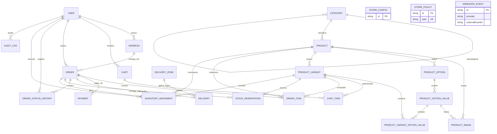

# 04 — Modelagem Definitiva de Dados e Schema Prisma

Este documento consolida o modelo lógico e físico do banco de dados em **PostgreSQL + Prisma ORM**, evoluindo as 15 entidades conceituais da v1.0 para **23 entidades** preparadas para produção, alta concorrência, auditoria e regras comerciais configuráveis.

---

## 1. Decisões Críticas de Modelagem

1. **Estratégia *Default Variant* (`Product` × `ProductVariant`):**
   - Todo `Product` possui obrigatoriamente ao menos 1 `ProductVariant`.
   - **Produto simples** (`hasVariants = false`): o sistema cria e mantém automaticamente 1 variante padrão oculta (`isDefault = true`, `optionCombinationKey = "DEFAULT"`, `label = "Padrão"`).
   - **Produto variável** (`hasVariants = true`): cada variação é uma `ProductVariant` conectada aos seus valores (`Preta`, `M`) pela tabela pivô `ProductVariantOptionValue` com chave canônica determinística `optionCombinationKey` (IDs dos `ProductOptionValue` ordenados lexicograficamente, ex.: `"optv_cor_preta|optv_tam_m"`). A restrição `@@unique([productId, optionCombinationKey])` impede variantes duplicadas.
   - **Benefício direto:** `CartItem`, `OrderItem`, `StockReservation` e `InventoryMovement` referenciam sempre `variantId` não nulo, eliminando código bifurcado entre produto simples e variável.
2. **Valores Monetários em Centavos Inteiros (`Int`):**
   - Todos os campos financeiros usam centavos de BRL em inteiros (`priceCents`, `subtotalCents`, `deliveryFeeCents`, `totalCents`, etc.), evitando imprecisões de ponto flutuante (`Float`).
3. **Controle Concorrente e Reserva Temporária de Estoque:**
   - `ProductVariant` armazena `stockOnHand` (estoque físico total) e `stockReserved` (unidades reservadas em checkouts pendentes).
   - O saldo vendável em tempo real é sempre **`stockOnHand - stockReserved`**.
   - Constraints SQL `CHECK` no PostgreSQL garantem no nível do banco que o estoque físico e o reservado nunca fiquem negativos nem inconsistentes.
4. **Snapshots Imutáveis no Pedido:**
   - `OrderItem` congela nome do produto, rótulo da variação, SKU, imagem e preço unitário no ato da compra (`RN15`).
   - `Order` congela dados do cliente e `shippingAddressSnapshot` (JSON completo do endereço), protegendo o pedido mesmo se o cliente alterar ou apagar o registro em `Address` (`RN27`).
   - `Delivery` congela nome da zona, taxa e label de prazo (`RN33`).
5. **Regras Comerciais Configuráveis e Auditabilidade:**
   - `StoreConfig`, `DeliveryZone` e `StorePolicy` eliminam hardcode das 12 decisões pendentes.
   - `OrderStatusHistory`, `InventoryMovement`, `WebhookEvent` e `AuditLog` garantem rastreabilidade completa e idempotência.
6. **Integridade Histórica (Soft Delete / Arquivamento):**
   - Produtos e variantes que já participaram de pedidos usam `status = ARCHIVED` e `deletedAt != null`, combinados com `onDelete: Restrict` em `OrderItem` e `InventoryMovement`.

---

## 2. Diagrama Entidade-Relacionamento (ER) Completo



---

## 3. Dicionário de Entidades e Políticas de Integridade (23 Entidades)

### 3.1. Origem das Entidades (15 Originais + 8 de Produção)

| Grupo | Entidades |
| --- | --- |
| **15 Originais da v1.0** | `User`, `Address`, `Category`, `Product`, `ProductImage`, `ProductOption`, `ProductOptionValue`, `ProductVariant`, `InventoryMovement`, `Cart`, `CartItem`, `Order`, `OrderItem`, `Payment`, `Delivery` |
| **8 Adicionadas para Produção** | `ProductVariantOptionValue`, `StockReservation`, `OrderStatusHistory`, `WebhookEvent`, `AuditLog`, `StoreConfig`, `DeliveryZone`, `StorePolicy` |

### 3.2. Resumo de Responsabilidade e Deleção

| Entidade | Responsabilidade Principal | Política de Deleção (`onDelete`) |
| --- | --- | --- |
| `User` | Clientes (`CUSTOMER`) e Lojista (`ADMIN`) | Anonimização LGPD quando houver pedidos (`deleted/anonymizedAt`); nunca remover fisicamente se houver `Order`. |
| `Address` | Endereços salvos do cliente | `Cascade` ao excluir usuário; `SetNull` em `Order.shippingAddressId` (snapshot preservado). |
| `Category` | Categorias e subcategorias (`parentId`) | `Restrict` se houver produtos vinculados; `SetNull` em subcategorias órfãs. |
| `Product` | Dados centrais do produto | Soft delete (`status = ARCHIVED`, `deletedAt`) se existir em `OrderItem`; `Restrict` no banco. |
| `ProductImage` | Imagens Cloudinary (opcionais por valor de opção/cor) | `Cascade` com `Product`; `SetNull` se valor de opção for removido. |
| `ProductOption` | Eixos de variação (ex.: Cor, Tamanho) | `Cascade` com `Product` (bloqueado na aplicação se já houver variantes em pedidos). |
| `ProductOptionValue` | Valores ordenados e swatch HEX opcional | `Cascade` com `ProductOption` / `ProductVariantOptionValue`. |
| `ProductVariant` | Unidade vendável (padrão ou combinação) com SKU e estoque | `Cascade` apenas em rascunho sem pedidos; `Restrict` em `OrderItem`, `StockReservation` e `InventoryMovement`. |
| `ProductVariantOptionValue` | Tabela pivô variante ↔ valor de opção | `Cascade` com `ProductVariant` e `ProductOptionValue`. |
| `InventoryMovement` | Livro razão imutável de entradas, reservas, baixas e devoluções | `Restrict` em `Product`/`ProductVariant` (nunca deletado). |
| `StockReservation` | Reserva temporária por pedido/variante com expiração | `Cascade` com `Order`; `Restrict` em `ProductVariant`. |
| `Cart` / `CartItem` | Carrinho visitante (`sessionToken`) ou autenticado (`userId`) | `Cascade` ao limpar carrinho, expirar TTL de visitante ou excluir usuário. |
| `Order` / `OrderItem` | Cabeçalho e itens imutáveis do pedido | `Restrict` em `User`, `Product` e `ProductVariant` (histórico permanente). |
| `OrderStatusHistory` | Auditoria cronológica de todas as mudanças de estado do pedido | `Cascade` com `Order`; `SetNull` no ator. |
| `Payment` | Tentativas e transações Pix / Cartão / Pagamento na entrega | `Cascade` com `Order` (preservado junto ao pedido). |
| `Delivery` | Registro logístico da entrega local ou retirada do pedido | `Cascade` com `Order`; `SetNull` se `DeliveryZone` for removida depois. |
| `DeliveryZone` | Regras configuráveis de cidade, CEPs/bairros, taxa e prazo | Pode ser desativada (`isActive = false`) sem afetar pedidos históricos. |
| `WebhookEvent` | Registro de deduplicação e auditoria de callbacks do gateway | Imutável (limpeza/arquivamento apenas por política de retenção). |
| `AuditLog` | Trilha administrativa imutável de ações do painel | Imutável (`SetNull` caso usuário ator seja anonimizado). |
| `StoreConfig` | Configurações globais da loja (identidade, reserva, retirada, limites) | Singleton (`id = "default"`). |
| `StorePolicy` | Conteúdo HTML/Markdown versionado de trocas, devoluções, privacidade e termos | Versionada no painel administrativo. |

---

## 4. Schema Prisma Definitivo (`prisma/schema.prisma`)

O schema abaixo segue exatamente os nomes canônicos de modelos e enums do projeto e está pronto para ser utilizado na tarefa `T04`.

```prisma
generator client {
  provider = "prisma-client-js"
}

datasource db {
  provider = "postgresql"
  url      = env("DATABASE_URL")
}

// ==========================================
// ENUMS CANONICOS
// ==========================================

enum UserRole {
  CUSTOMER
  ADMIN
}

enum ProductStatus {
  DRAFT
  ACTIVE
  INACTIVE
  ARCHIVED
}

enum InventoryMovementType {
  INITIAL
  MANUAL_ADJUSTMENT_IN
  MANUAL_ADJUSTMENT_OUT
  RESERVE
  RELEASE
  SALE
  RETURN
}

enum StockReservationStatus {
  ACTIVE
  CONFIRMED
  RELEASED
  EXPIRED
}

enum OrderStatus {
  AWAITING_PAYMENT
  PAID
  PREPARING
  OUT_FOR_DELIVERY
  READY_FOR_PICKUP
  DELIVERED
  CANCELLED
  EXPIRED
  REFUNDED
}

enum PaymentMethod {
  PIX
  CREDIT_CARD
  DEBIT_CARD
  PAY_ON_DELIVERY
}

enum PaymentStatus {
  PENDING
  AUTHORIZED
  PAID
  FAILED
  EXPIRED
  REFUNDED
  PARTIALLY_REFUNDED
}

enum DeliveryMethod {
  LOCAL_DELIVERY
  STORE_PICKUP
}

enum DeliveryStatus {
  PENDING
  PREPARING
  OUT_FOR_DELIVERY
  READY_FOR_PICKUP
  DELIVERED
  FAILED_ATTEMPT
  CANCELLED
}

enum DeliveryMatchType {
  CEP_RANGE
  NEIGHBORHOOD
  CITY_FLAT
}

enum WebhookEventStatus {
  RECEIVED
  PROCESSED
  IGNORED
  FAILED
}

enum PolicyType {
  EXCHANGE
  RETURN
  PRIVACY
  TERMS
  SHIPPING
}

// ==========================================
// USUARIOS E ENDERECOS
// ==========================================

model User {
  id            String    @id @default(cuid())
  name          String
  email         String    @unique
  emailVerified DateTime?
  passwordHash  String?
  phone         String?
  cpf           String?
  role          UserRole  @default(CUSTOMER)
  isActive      Boolean   @default(true)
  anonymizedAt  DateTime?
  createdAt     DateTime  @default(now())
  updatedAt     DateTime  @updatedAt

  addresses          Address[]
  carts              Cart[]
  orders             Order[]
  orderStatusChanges OrderStatusHistory[] @relation("OrderStatusChangedBy")
  inventoryMovements InventoryMovement[]  @relation("InventoryMovementActor")
  auditLogs          AuditLog[]           @relation("AuditLogActor")

  @@index([role])
  @@index([createdAt])
}

model Address {
  id             String   @id @default(cuid())
  userId         String
  label          String?
  recipientName  String
  phone          String
  cep            String
  street         String
  number         String
  complement     String?
  neighborhood   String
  city           String
  state          String
  referencePoint String?
  isDefault      Boolean  @default(false)
  createdAt      DateTime @default(now())
  updatedAt      DateTime @updatedAt

  user   User    @relation(fields: [userId], references: [id], onDelete: Cascade)
  orders Order[]

  @@index([userId])
  @@index([cep])
}

// ==========================================
// CATALOGO, PRODUTOS E VARIANTES
// ==========================================

model Category {
  id          String   @id @default(cuid())
  name        String
  slug        String   @unique
  description String?
  imageUrl    String?
  parentId    String?
  sortOrder   Int      @default(0)
  isActive    Boolean  @default(true)
  createdAt   DateTime @default(now())
  updatedAt   DateTime @updatedAt

  parent   Category?  @relation("CategoryHierarchy", fields: [parentId], references: [id], onDelete: SetNull)
  children Category[] @relation("CategoryHierarchy")
  products Product[]

  @@index([parentId])
  @@index([isActive, sortOrder])
}

model Product {
  id                  String        @id @default(cuid())
  name                String
  slug                String        @unique
  description         String
  shortDescription    String?
  categoryId          String
  basePriceCents      Int
  compareAtPriceCents Int?
  hasVariants         Boolean       @default(false)
  status              ProductStatus @default(DRAFT)
  seoTitle            String?
  seoDescription      String?
  sizeGuideMarkdown   String?
  deletedAt           DateTime?
  createdAt           DateTime      @default(now())
  updatedAt           DateTime      @updatedAt

  category           Category            @relation(fields: [categoryId], references: [id], onDelete: Restrict)
  images             ProductImage[]
  options            ProductOption[]
  variants           ProductVariant[]
  orderItems         OrderItem[]
  inventoryMovements InventoryMovement[]

  @@index([categoryId, status, deletedAt])
  @@index([status, basePriceCents])
  @@index([status, createdAt])
}

model ProductImage {
  id                 String   @id @default(cuid())
  productId          String
  optionValueId      String?
  cloudinaryPublicId String
  url                String
  altText            String
  sortOrder          Int      @default(0)
  isPrimary          Boolean  @default(false)
  createdAt          DateTime @default(now())

  product     Product             @relation(fields: [productId], references: [id], onDelete: Cascade)
  optionValue ProductOptionValue? @relation(fields: [optionValueId], references: [id], onDelete: SetNull)

  @@index([productId, sortOrder])
  @@index([optionValueId])
}

model ProductOption {
  id         String  @id @default(cuid())
  productId  String
  name       String
  slug       String
  isRequired Boolean @default(true)
  sortOrder  Int     @default(0)

  product Product              @relation(fields: [productId], references: [id], onDelete: Cascade)
  values  ProductOptionValue[]

  @@unique([productId, slug])
  @@index([productId, sortOrder])
}

model ProductOptionValue {
  id        String  @id @default(cuid())
  optionId  String
  value     String
  slug      String
  colorHex  String?
  sortOrder Int     @default(0)

  option       ProductOption               @relation(fields: [optionId], references: [id], onDelete: Cascade)
  variantLinks ProductVariantOptionValue[]
  images       ProductImage[]

  @@unique([optionId, slug])
  @@index([optionId, sortOrder])
}

model ProductVariant {
  id                   String    @id @default(cuid())
  productId            String
  sku                  String    @unique
  isDefault            Boolean   @default(false)
  optionCombinationKey String
  label                String
  priceCents           Int
  compareAtPriceCents  Int?
  stockOnHand          Int       @default(0)
  stockReserved        Int       @default(0)
  isActive             Boolean   @default(true)
  deletedAt            DateTime?
  createdAt            DateTime  @default(now())
  updatedAt            DateTime  @updatedAt

  product            Product                     @relation(fields: [productId], references: [id], onDelete: Cascade)
  optionValues       ProductVariantOptionValue[]
  inventoryMovements InventoryMovement[]
  stockReservations  StockReservation[]
  cartItems          CartItem[]
  orderItems         OrderItem[]

  @@unique([productId, optionCombinationKey])
  @@index([productId, isActive, deletedAt])
  @@index([priceCents])
}

model ProductVariantOptionValue {
  variantId     String
  optionValueId String

  variant     ProductVariant     @relation(fields: [variantId], references: [id], onDelete: Cascade)
  optionValue ProductOptionValue @relation(fields: [optionValueId], references: [id], onDelete: Cascade)

  @@id([variantId, optionValueId])
  @@index([optionValueId])
}

// ==========================================
// ESTOQUE E RESERVAS
// ==========================================

model InventoryMovement {
  id                 String                @id @default(cuid())
  productId          String
  variantId          String
  orderId            String?
  actorUserId        String?
  type               InventoryMovementType
  quantityDelta      Int
  reservedDelta      Int                   @default(0)
  stockOnHandAfter   Int
  stockReservedAfter Int
  reason             String?
  createdAt          DateTime              @default(now())

  product Product        @relation(fields: [productId], references: [id], onDelete: Restrict)
  variant ProductVariant @relation(fields: [variantId], references: [id], onDelete: Restrict)
  order   Order?         @relation(fields: [orderId], references: [id], onDelete: SetNull)
  actor   User?          @relation("InventoryMovementActor", fields: [actorUserId], references: [id], onDelete: SetNull)

  @@index([variantId, createdAt])
  @@index([orderId])
  @@index([createdAt])
}

model StockReservation {
  id          String                 @id @default(cuid())
  orderId     String
  variantId   String
  quantity    Int
  status      StockReservationStatus @default(ACTIVE)
  expiresAt   DateTime
  confirmedAt DateTime?
  releasedAt  DateTime?
  createdAt   DateTime               @default(now())
  updatedAt   DateTime               @updatedAt

  order   Order          @relation(fields: [orderId], references: [id], onDelete: Cascade)
  variant ProductVariant @relation(fields: [variantId], references: [id], onDelete: Restrict)

  @@unique([orderId, variantId])
  @@index([status, expiresAt])
  @@index([variantId, status])
}

// ==========================================
// CARRINHO
// ==========================================

model Cart {
  id           String    @id @default(cuid())
  userId       String?
  sessionToken String?   @unique
  expiresAt    DateTime?
  convertedAt  DateTime?
  createdAt    DateTime  @default(now())
  updatedAt    DateTime  @updatedAt

  user  User?      @relation(fields: [userId], references: [id], onDelete: Cascade)
  items CartItem[]

  @@index([userId, convertedAt])
  @@index([expiresAt])
}

model CartItem {
  id                 String   @id @default(cuid())
  cartId             String
  variantId          String
  quantity           Int
  unitPriceAtAddCents Int
  createdAt          DateTime @default(now())
  updatedAt          DateTime @updatedAt

  cart    Cart           @relation(fields: [cartId], references: [id], onDelete: Cascade)
  variant ProductVariant @relation(fields: [variantId], references: [id], onDelete: Cascade)

  @@unique([cartId, variantId])
  @@index([variantId])
}

// ==========================================
// PEDIDOS, PAGAMENTOS E ENTREGA LOCAL
// ==========================================

model Order {
  id                      String         @id @default(cuid())
  orderNumber             String         @unique
  idempotencyKey          String         @unique
  userId                  String
  status                  OrderStatus    @default(AWAITING_PAYMENT)
  paymentStatus           PaymentStatus  @default(PENDING)
  deliveryMethod          DeliveryMethod
  subtotalCents           Int
  deliveryFeeCents        Int
  discountCents           Int            @default(0)
  totalCents              Int
  customerNameSnapshot    String
  customerEmailSnapshot   String
  customerPhoneSnapshot   String?
  shippingAddressId       String?
  shippingAddressSnapshot Json?
  notes                   String?
  requiresManualReview    Boolean        @default(false)
  paidAt                  DateTime?
  cancelledAt             DateTime?
  createdAt               DateTime       @default(now())
  updatedAt               DateTime       @updatedAt

  user               User                 @relation(fields: [userId], references: [id], onDelete: Restrict)
  shippingAddress    Address?             @relation(fields: [shippingAddressId], references: [id], onDelete: SetNull)
  items              OrderItem[]
  payments           Payment[]
  delivery           Delivery?
  statusHistory      OrderStatusHistory[]
  stockReservations  StockReservation[]
  inventoryMovements InventoryMovement[]

  @@index([userId, createdAt])
  @@index([status, createdAt])
  @@index([requiresManualReview, status])
}

model OrderItem {
  id                   String   @id @default(cuid())
  orderId              String
  productId            String
  variantId            String
  productNameSnapshot  String
  variantLabelSnapshot String
  skuSnapshot          String
  imageUrlSnapshot     String?
  quantity             Int
  unitPriceCents       Int
  lineTotalCents       Int
  createdAt            DateTime @default(now())

  order   Order          @relation(fields: [orderId], references: [id], onDelete: Cascade)
  product Product        @relation(fields: [productId], references: [id], onDelete: Restrict)
  variant ProductVariant @relation(fields: [variantId], references: [id], onDelete: Restrict)

  @@index([orderId])
  @@index([variantId])
}

model OrderStatusHistory {
  id              String       @id @default(cuid())
  orderId         String
  fromStatus      OrderStatus?
  toStatus        OrderStatus
  changedByUserId String?
  actorType       String
  reason          String?
  createdAt       DateTime     @default(now())

  order     Order @relation(fields: [orderId], references: [id], onDelete: Cascade)
  changedBy User? @relation("OrderStatusChangedBy", fields: [changedByUserId], references: [id], onDelete: SetNull)

  @@index([orderId, createdAt])
}

model Payment {
  id                String        @id @default(cuid())
  orderId           String
  provider          String
  method            PaymentMethod
  status            PaymentStatus @default(PENDING)
  amountCents       Int
  installments      Int           @default(1)
  externalPaymentId String?
  idempotencyKey    String        @unique
  pixQrCodeBase64   String?
  pixCopyPaste      String?
  pixExpiresAt      DateTime?
  failureCode       String?
  failureMessage    String?
  rawMetadata       Json?
  paidAt            DateTime?
  refundedAt        DateTime?
  createdAt         DateTime      @default(now())
  updatedAt         DateTime      @updatedAt

  order Order @relation(fields: [orderId], references: [id], onDelete: Cascade)

  @@index([orderId])
  @@index([provider, externalPaymentId])
  @@index([status, pixExpiresAt])
}

model DeliveryZone {
  id                   String            @id @default(cuid())
  name                 String
  city                 String
  state                String
  matchType            DeliveryMatchType
  cepStart             String?
  cepEnd               String?
  neighborhoods        String[]
  feeCents             Int
  freeShippingMinCents Int?
  estimatedDaysMin     Int               @default(0)
  estimatedDaysMax     Int               @default(1)
  estimatedLabel       String
  isActive             Boolean           @default(true)
  sortOrder            Int               @default(0)
  createdAt            DateTime          @default(now())
  updatedAt            DateTime          @updatedAt

  deliveries Delivery[]

  @@index([isActive, city, state, sortOrder])
}

model Delivery {
  id                       String         @id @default(cuid())
  orderId                  String         @unique
  deliveryZoneId           String?
  method                   DeliveryMethod
  status                   DeliveryStatus @default(PENDING)
  deliveryZoneNameSnapshot String?
  feeCents                 Int            @default(0)
  estimatedLabelSnapshot   String?
  trackingCode             String?
  deliveredAt              DateTime?
  notes                    String?
  createdAt                DateTime       @default(now())
  updatedAt                DateTime       @updatedAt

  order        Order         @relation(fields: [orderId], references: [id], onDelete: Cascade)
  deliveryZone DeliveryZone? @relation(fields: [deliveryZoneId], references: [id], onDelete: SetNull)

  @@index([status])
  @@index([deliveryZoneId])
}

// ==========================================
// WEBHOOKS, AUDITORIA E CONFIGURACOES
// ==========================================

model WebhookEvent {
  id              String             @id @default(cuid())
  provider        String
  externalEventId String
  eventType       String
  status          WebhookEventStatus @default(RECEIVED)
  signatureValid  Boolean
  payload         Json
  errorMessage    String?
  processedAt     DateTime?
  createdAt       DateTime           @default(now())

  @@unique([provider, externalEventId])
  @@index([status, createdAt])
}

model AuditLog {
  id          String   @id @default(cuid())
  actorUserId String?
  action      String
  entityType  String
  entityId    String
  beforeState Json?
  afterState  Json?
  ipAddress   String?
  userAgent   String?
  createdAt   DateTime @default(now())

  actor User? @relation("AuditLogActor", fields: [actorUserId], references: [id], onDelete: SetNull)

  @@index([entityType, entityId, createdAt])
  @@index([actorUserId, createdAt])
}

model StoreConfig {
  id                        String   @id @default("default")
  storeName                 String
  legalName                 String?
  cnpj                      String?
  supportEmail              String
  supportWhatsapp           String?
  physicalAddress           String?
  serviceHours              String?
  primaryCity               String?
  primaryState              String?
  minOrderCents             Int      @default(0)
  storePickupEnabled        Boolean  @default(false)
  storePickupAddress        String?
  storePickupInstructions   String?
  payOnDeliveryEnabled      Boolean  @default(false)
  pixReservationMinutes     Int      @default(30)
  cardReservationMinutes    Int      @default(15)
  maxImagesPerProduct       Int      @default(8)
  maxInstallments           Int      @default(6)
  minInstallmentCents       Int      @default(2000)
  activePaymentProvider     String   @default("mercadopago")
  requiredVariantAttributes String[]
  updatedAt                 DateTime @updatedAt
}

model StorePolicy {
  id              String     @id @default(cuid())
  type            PolicyType @unique
  title           String
  slug            String     @unique
  contentMarkdown String
  version         Int        @default(1)
  publishedAt     DateTime?
  updatedAt       DateTime   @updatedAt
}
```

---

## 5. Constraints SQL Complementares (Migration Customizada em `T04`)

O Prisma não declara nativamente `CHECK` constraints nem índices únicos parciais (`WHERE ...`). Portanto, após gerar a migration inicial com `--create-only`, adicionar este bloco SQL antes de aplicar `prisma migrate deploy`:

```sql
-- Garantir integridade absoluta de estoque e quantidades
ALTER TABLE "ProductVariant"
  ADD CONSTRAINT "chk_variant_stock_on_hand_non_negative" CHECK ("stockOnHand" >= 0),
  ADD CONSTRAINT "chk_variant_stock_reserved_non_negative" CHECK ("stockReserved" >= 0),
  ADD CONSTRAINT "chk_variant_stock_reserved_lte_on_hand" CHECK ("stockReserved" <= "stockOnHand"),
  ADD CONSTRAINT "chk_variant_price_non_negative" CHECK ("priceCents" >= 0);

ALTER TABLE "Product"
  ADD CONSTRAINT "chk_product_base_price_non_negative" CHECK ("basePriceCents" >= 0);

ALTER TABLE "CartItem"
  ADD CONSTRAINT "chk_cart_item_quantity_positive" CHECK ("quantity" > 0);

ALTER TABLE "OrderItem"
  ADD CONSTRAINT "chk_order_item_quantity_positive" CHECK ("quantity" > 0),
  ADD CONSTRAINT "chk_order_item_unit_price_non_negative" CHECK ("unitPriceCents" >= 0);

ALTER TABLE "StockReservation"
  ADD CONSTRAINT "chk_stock_reservation_quantity_positive" CHECK ("quantity" > 0);

-- Garantir no maximo 1 variante padrao por produto
CREATE UNIQUE INDEX "uq_product_single_default_variant"
  ON "ProductVariant" ("productId")
  WHERE ("isDefault" = true);

-- Garantir no maximo 1 carrinho ativo (nao convertido) por usuario autenticado
CREATE UNIQUE INDEX "uq_cart_single_active_per_user"
  ON "Cart" ("userId")
  WHERE ("userId" IS NOT NULL AND "convertedAt" IS NULL);

-- Garantir no maximo 1 carrinho ativo por token de visitante
CREATE UNIQUE INDEX "uq_cart_single_active_per_session"
  ON "Cart" ("sessionToken")
  WHERE ("sessionToken" IS NOT NULL AND "convertedAt" IS NULL);
```

---

## 6. Estratégia de Índices e Seed Inicial (`prisma/seed.ts`)

### Índices Críticos de Desempenho
- **Catálogo e filtros:** `Product(categoryId, status, deletedAt)`, `Product(status, basePriceCents)`, `ProductVariant(productId, isActive, deletedAt)`, `ProductVariant(priceCents)`.
- **Lookup de variante e SKU:** `ProductVariant.sku` único; `ProductVariant(productId, optionCombinationKey)` único; `ProductVariantOptionValue(optionValueId)` para filtragem eficiente por cor ou tamanho na PLP.
- **Rotina de expiração de estoque:** `StockReservation(status, expiresAt)` permite que o cron encontre reservas vencidas em milissegundos mesmo com milhares de pedidos históricos.
- **Área do cliente e painel Admin:** `Order(userId, createdAt)`, `Order(status, createdAt)` e `Order(requiresManualReview, status)`.

### Dados Iniciais do `prisma/seed.ts` (Ambiente Dev/Staging)
1. **Usuário `ADMIN` inicial** (credenciais lidas de variáveis de ambiente de seed, nunca senha fixa em produção).
2. **`StoreConfig` padrão (`id = "default"`)** com valores provisórios configuráveis (`pixReservationMinutes = 30`, `cardReservationMinutes = 15`, `maxImagesPerProduct = 8`, `storePickupEnabled = false`, `payOnDeliveryEnabled = false`, `minOrderCents = 0`, `requiredVariantAttributes = ["Cor", "Tamanho"]`).
3. **`StorePolicy` base** para `EXCHANGE`, `RETURN` (citando prazo mínimo de 7 dias do CDC), `PRIVACY`, `TERMS` e `SHIPPING` marcadas como rascunho até aprovação em [01-APROVACAO-COMERCIAL-CLIENTE.md](./01-APROVACAO-COMERCIAL-CLIENTE.md).
4. **Categorias e 4–6 produtos de demonstração** (ex.: 1 bolsa simples `hasVariants = false` + camisetas/vestidos com grade `Cor × Tamanho` incluindo variação com estoque `0` para testar `CA03`–`CA05`).
5. **1 `DeliveryZone` de teste** para validação do fluxo de entrega local em desenvolvimento/staging.
