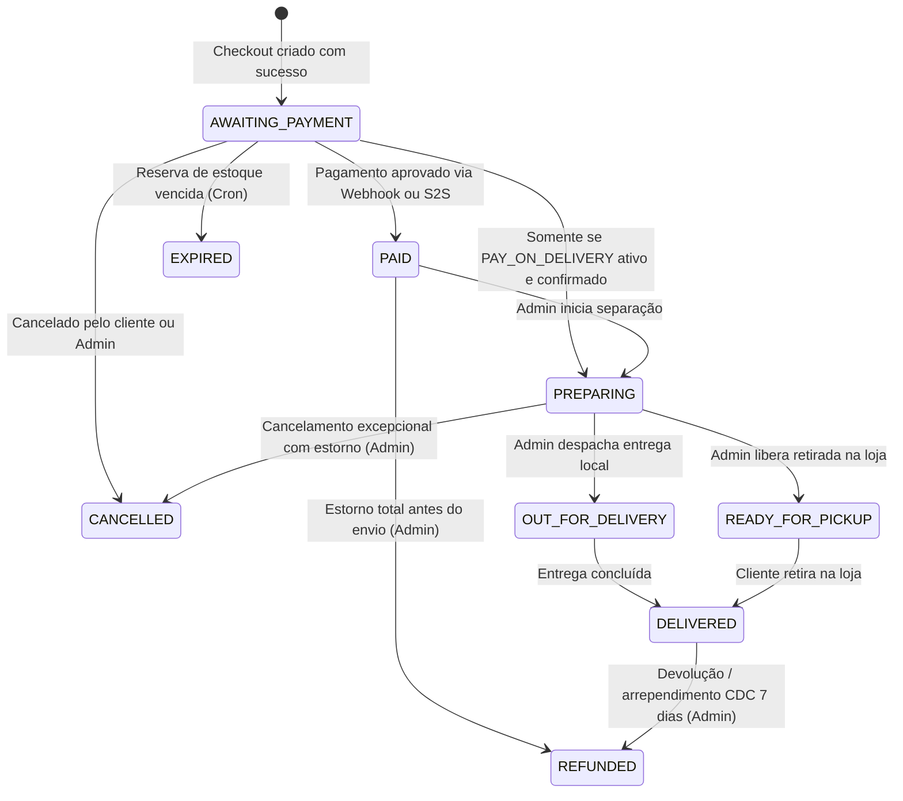
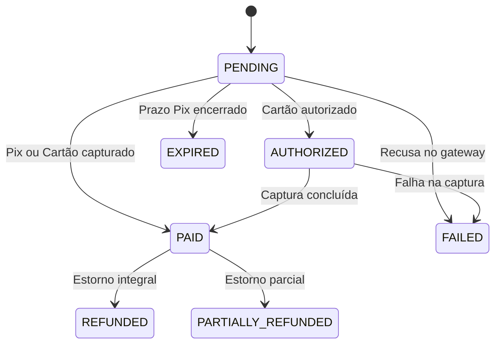
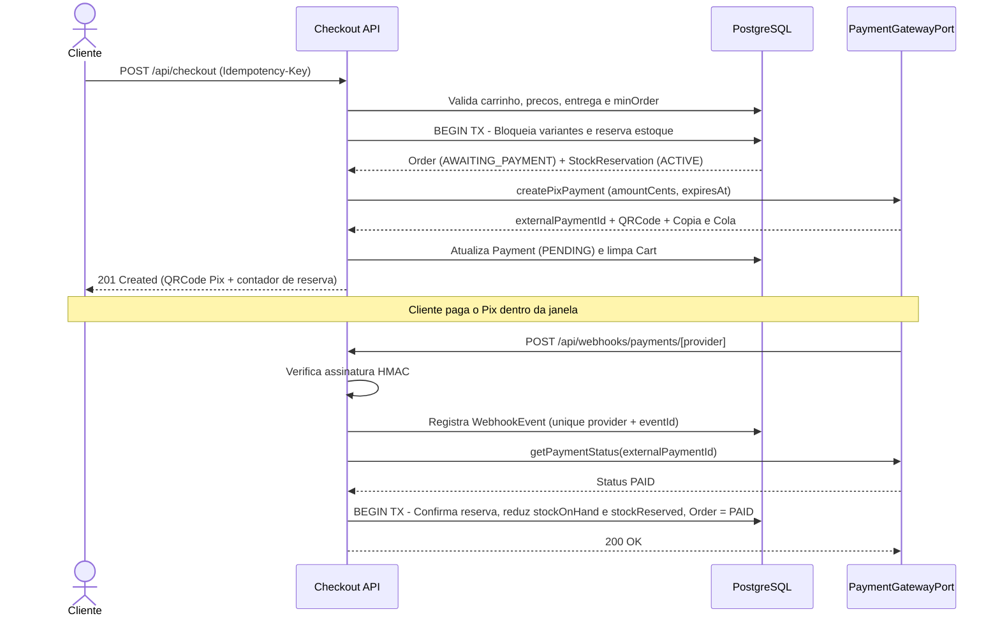
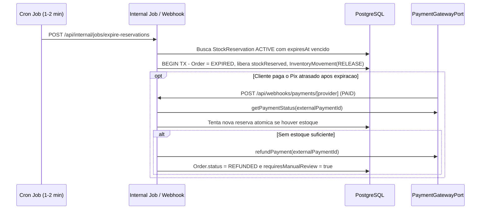
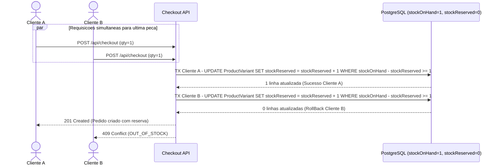
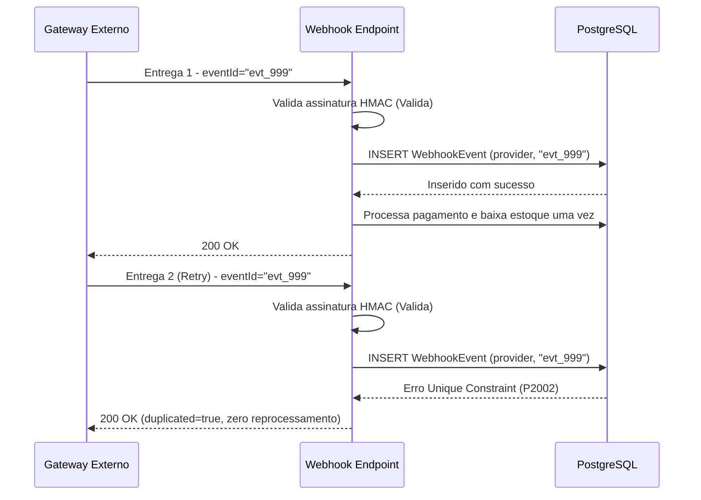

# 05 — Máquinas de Estado, Contratos de API e Fluxos Críticos

Este documento especifica as máquinas de estado formais do sistema, os padrões globais de resposta/erro de API, os contratos de todos os endpoints públicos, autenticados, administrativos e de integração (webhooks/jobs) e os diagramas de sequência dos fluxos críticos de concorrência e pagamento.

---

## 1. Máquinas de Estado Definitivas

### 1.1. `OrderStatus` (Ciclo de Vida do Pedido)



| De | Para | Ator Permitido | Efeitos Colaterais Obrigatórios |
| --- | --- | --- | --- |
| `(novo)` | `AWAITING_PAYMENT` | Sistema (Checkout) | Cria `StockReservation(ACTIVE)` e `InventoryMovement(RESERVE)` em transação. |
| `AWAITING_PAYMENT` | `PAID` | Webhook / Sistema | Confirma `StockReservation(CONFIRMED)`, baixa `stockOnHand` e `stockReserved`, grava `InventoryMovement(SALE)`, registra `paidAt` e dispara e-mail. |
| `AWAITING_PAYMENT` | `EXPIRED` | Sistema (Cron) | Marca `StockReservation(EXPIRED)`, decrementa `stockReserved`, grava `InventoryMovement(RELEASE)` e marca `Payment(EXPIRED)`. |
| `AWAITING_PAYMENT` | `CANCELLED` | Cliente (dono) / Admin | Marca `StockReservation(RELEASED)`, decrementa `stockReserved`, grava `InventoryMovement(RELEASE)` e `OrderStatusHistory`. |
| `PAID` | `PREPARING` | Admin | Atualiza `Delivery.status = PREPARING`, grava `OrderStatusHistory` + `AuditLog`. |
| `PREPARING` | `OUT_FOR_DELIVERY` | Admin (se `LOCAL_DELIVERY`) | Atualiza `Delivery.status = OUT_FOR_DELIVERY`, grava `OrderStatusHistory` + `AuditLog` e notifica cliente. |
| `PREPARING` | `READY_FOR_PICKUP` | Admin (se `STORE_PICKUP`) | Atualiza `Delivery.status = READY_FOR_PICKUP`, grava `OrderStatusHistory` + `AuditLog` e notifica cliente. |
| `OUT_FOR_DELIVERY` / `READY_FOR_PICKUP` | `DELIVERED` | Admin | Atualiza `Delivery.status = DELIVERED` e `deliveredAt`, grava `OrderStatusHistory` + `AuditLog`. |
| `PAID` / `PREPARING` / `DELIVERED` | `REFUNDED` | Admin | Aciona `refundPayment()` no gateway, atualiza `Payment(REFUNDED)` e opcionalmente repõe estoque (`InventoryMovement(RETURN)`) se peça retornar íntegra. |

### 1.2. `PaymentStatus`, `DeliveryStatus` e `StockReservationStatus`



| Máquina | Estados Válidos | Regras de Sincronização |
| --- | --- | --- |
| **`DeliveryStatus`** | `PENDING` → `PREPARING` → `OUT_FOR_DELIVERY` ou `READY_FOR_PICKUP` → `DELIVERED` (ou `FAILED_ATTEMPT` → `OUT_FOR_DELIVERY` / `CANCELLED`) | Sempre sincronizada com `OrderStatus` quando avançada no Admin. Em caso de `FAILED_ATTEMPT`, o pedido permanece em entrega e registra observação para nova tentativa. |
| **`StockReservationStatus`** | `ACTIVE` → `CONFIRMED` (pagamento aprovado) \| `RELEASED` (cancelamento/falha síncrona de cartão) \| `EXPIRED` (cron após `expiresAt`) | Toda transição diferente de `ACTIVE` é **terminal** e nunca pode reduzir `stockReserved` mais de uma vez (validado por `WHERE status = 'ACTIVE'`). |

---

## 2. Padrões Globais da API

- **Base URL:** `/api/...` (JSON UTF-8).
- **Validação:** Todos os payloads de entrada e query params validados com **Zod**.
- **Envelope de Sucesso:**
  - Recurso único: `{ "data": { ... } }`
  - Coleção paginada: `{ "data": [ ... ], "meta": { "page": 1, "pageSize": 20, "total": 84, "totalPages": 5 } }`
- **Envelope de Erro Padronizado:**
  ```json
  {
    "error": {
      "code": "OUT_OF_COVERAGE_AREA",
      "message": "O CEP informado está fora da nossa área de entrega local.",
      "details": { "cep": "01001000" },
      "requestId": "req_01J..."
    }
  }
  ```
- **Códigos HTTP:**
  - `200 OK` / `201 Created`: operação concluída.
  - `400 Bad Request`: JSON inválido ou cabeçalho obrigatório ausente (ex.: falta de `Idempotency-Key`).
  - `401 Unauthorized`: usuário não autenticado.
  - `403 Forbidden`: autenticado sem permissão (`ADMIN` exigido ou tentativa de acessar pedido de terceiro `CA14`).
  - `404 Not Found`: recurso inexistente ou inativo na loja pública.
  - `409 Conflict`: conflito de estado, SKU/slug duplicado, estoque insuficiente em compra concorrente (`CA11`) ou transição de status inválida.
  - `422 Unprocessable Entity`: erro semântico de validação Zod, pedido mínimo não atingido ou CEP fora da cobertura (`CA12`).
  - `429 Too Many Requests`: limite de taxa atingido (inclui `Retry-After`).
  - `500 Internal Server Error` / `502 Bad Gateway`: erro inesperado ou indisponibilidade do provedor externo.

---

## 3. Contratos de Endpoints por Domínio

### 3.1. Autenticação e Conta (`Auth`)

| Método e Rota | Acesso | Entrada Principal | Saída / Regras |
| --- | --- | --- | --- |
| `POST /api/auth/register` | Público | `{ name, email, password, phone?, acceptTerms: true }` | Cria `User(CUSTOMER)`, gera sessão `HttpOnly`, executa **merge automático do carrinho visitante** (`RN30`) e retorna `201`. |
| `POST /api/auth/login` | Público | `{ email, password }` | Verifica hash Argon2id/bcrypt, emite sessão, executa **merge automático do carrinho visitante** e retorna dados do usuário + resumo de avisos de merge (se houve ajuste de estoque). |
| `POST /api/auth/logout` | Autenticado | — | Invalida sessão e remove cookie de autenticação (mantém cookie anônimo limpo). |
| `POST /api/auth/forgot-password` | Público | `{ email }` | Sempre retorna `200` (anti-enumeração de contas). Se o e-mail existir, gera token CSPRNG (hash SHA-256 salvo com TTL 30 min) e dispara e-mail via Resend. |
| `POST /api/auth/reset-password` | Público | `{ token, newPassword }` | Valida token em hash e expiração, atualiza `passwordHash` e invalida sessões anteriores. |
| `GET /api/me` | Autenticado | — | Retorna perfil do usuário logado (`id`, `name`, `email`, `phone`, `role`). Nunca retorna `passwordHash`. |

### 3.2. Catálogo Público (`Catalog`)

| Método e Rota | Acesso | Query / Params | Saída / Regras |
| --- | --- | --- | --- |
| `GET /api/categories` | Público | `?includeEmpty=false` | Árvore de categorias e subcategorias com `isActive = true`, ordenadas por `sortOrder`. |
| `GET /api/products` | Público | `q`, `category` (slug), `color` (slugs), `size` (slugs), `minPriceCents`, `maxPriceCents`, `inStockOnly` (`true`/`false`), `sort` (`price_asc` \| `price_desc` \| `newest`), `page`, `pageSize` | Retorna apenas `status = ACTIVE` e `deletedAt = null` (`RN06`). Calcula `inStock` considerando se há ao menos 1 variante ativa com `stockOnHand - stockReserved > 0`. |
| `GET /api/products/[slug]` | Público | `slug` | Retorna produto completo, `images` (ordenadas), `options` e `variants` ativas com `availableStock = stockOnHand - stockReserved` e `inStock`. Retorna `404` se inativo/arquivado. |

### 3.3. Carrinho (`Cart`)

Todos os preços retornados no carrinho são recalculados em tempo real a partir de `ProductVariant.priceCents` no PostgreSQL (`RN08`, `RN12`).

| Método e Rota | Acesso | Entrada | Saída / Regras |
| --- | --- | --- | --- |
| `GET /api/cart` | Visitante ou Cliente | Cookie `cart_session` ou sessão | Retorna itens com dados atuais da variante, `availableStock`, `subtotalCents`, `priceChanges[]` (comparando `unitPriceAtAddCents` vs `ProductVariant.priceCents` atual conforme `RN13`) e `stockWarnings[]`. |
| `POST /api/cart/items` | Visitante ou Cliente | `{ variantId, quantity }` (`quantity >= 1`) | Valida se produto e variante estão ativos e não deletados; exige `availableStock >= (qtdAtualNoCarrinho + quantity)` (`CA05`, `RN11`); cria `Cart` visitante se necessário (`expiresAt = +30 dias`). |
| `PATCH /api/cart/items/[itemId]` | Visitante ou Cliente | `{ quantity }` (`quantity >= 0`) | Se `quantity = 0`, remove item; caso contrário, valida estoque disponível e atualiza quantidade (`CA06`). |
| `DELETE /api/cart/items/[itemId]` | Visitante ou Cliente | `itemId` | Remove o item garantindo que pertence ao `Cart` do usuário/sessão atual. |
| `POST /api/cart/merge` | Autenticado | Automático pós-login | Para cada `CartItem` do carrinho visitante: soma com o mesmo `variantId` do usuário, limita a `Math.min(soma, availableStock)`, descarta itens indisponíveis, marca carrinho visitante com `convertedAt = now()` e retorna lista de avisos para exibir ao usuário (`RN30`). |

### 3.4. Endereços e Entrega Local (`Delivery`)

| Método e Rota | Acesso | Entrada | Saída / Regras |
| --- | --- | --- | --- |
| `GET /api/addresses` | Cliente | — | Lista endereços do `session.user.id`. |
| `POST /api/addresses` | Cliente | `{ label?, recipientName, phone, cep, street, number, complement?, neighborhood, city, state, referencePoint?, isDefault? }` | Valida CEP (8 dígitos numéricos); se `isDefault = true`, desmarca o anterior na mesma transação. |
| `PATCH /api/addresses/[id]` / `DELETE /api/addresses/[id]` | Cliente | `id` | Filtra por `{ id, userId: session.user.id }` (proteção IDOR). |
| `POST /api/delivery/quote` | Visitante ou Cliente | `{ cep, neighborhood?, city?, state?, subtotalCents? }` | Lê `StoreConfig` e `DeliveryZone(isActive = true)`. Ordem de match: `CEP_RANGE` → `NEIGHBORHOOD` (normalizado sem acentos/case) → `CITY_FLAT`. Se nenhuma zona atender, retorna **`422 OUT_OF_COVERAGE_AREA`** (`CA12`) para `LOCAL_DELIVERY`, mas ainda informa `pickupOption` se `storePickupEnabled = true`. Aplica `freeShippingMinCents` quando atingido. |

### 3.5. Checkout e Pedidos do Cliente (`Checkout`, `Orders`)

| Método e Rota | Acesso | Entrada | Saída / Regras |
| --- | --- | --- | --- |
| `POST /api/checkout` | Cliente | Header **`Idempotency-Key`** + `{ deliveryMethod, addressId?, paymentMethod, installments?, cardToken?, notes? }` | 1. Se `Idempotency-Key` já existir em `Order`, retorna o pedido criado originalmente (`200`).<br>2. Valida carrinho não vazio, `StoreConfig.minOrderCents`, elegibilidade da zona de entrega (`CA12`) ou retirada habilitada, e `payOnDeliveryEnabled` se `PAY_ON_DELIVERY`.<br>3. Ignora qualquer preço enviado pelo cliente (`CA07`).<br>4. Em transação SQL: bloqueia variantes com `SELECT ... FOR UPDATE` ou update condicional `WHERE stockOnHand - stockReserved >= qty`, incrementa `stockReserved`, grava `StockReservation(ACTIVE)` e `InventoryMovement(RESERVE)`, cria `Order`, `OrderItem` (snapshots) e `Delivery`.<br>5. Invoca `PaymentGatewayPort`. Se cartão retornar `FAILED` imediato no gateway, executa compensação transacional liberando `StockReservation(RELEASED)` e retornando `422 PAYMENT_DECLINED`.<br>6. Limpa carrinho do usuário e retorna `201` com `orderNumber`, QR Pix/Copia e Cola + `pixExpiresAt` (ou status do cartão). |
| `GET /api/orders` | Cliente | `page`, `pageSize` | Lista apenas pedidos onde `userId = session.user.id` (`RN18`). |
| `GET /api/orders/[id]` | Cliente | `id` | Valida `order.userId === session.user.id || role === 'ADMIN'`; caso contrário retorna **`403 FORBIDDEN`** (`CA14`). |
| `POST /api/orders/[id]/cancel` | Cliente | `id` + `{ reason? }` | Permitido apenas ao dono enquanto `status === 'AWAITING_PAYMENT'`. Libera reservas e atualiza pedido para `CANCELLED`. |

### 3.6. Webhooks e Jobs Internos (`Payments`, `Inventory`)

| Método e Rota | Acesso | Entrada | Saída / Regras |
| --- | --- | --- | --- |
| `POST /api/webhooks/payments/[provider]` | Gateway Externo | Corpo bruto + headers de assinatura | 1. Valida `verifyWebhookSignature()`; se inválida, grava/loga tentativa suspeita e retorna `401`.<br>2. Tenta inserir `WebhookEvent(provider, externalEventId)`; se violar `@@unique`, retorna **`200 { duplicated: true }`** sem reprocessar (`CA10`).<br>3. Consulta o gateway S2S via `getPaymentStatus(externalPaymentId)` (nunca confia cegamente apenas no payload).<br>4. Se pagamento `PAID` e pedido `AWAITING_PAYMENT` com reservas `ACTIVE`: confirma reservas, reduz `stockOnHand` e `stockReserved`, grava `InventoryMovement(SALE)` e muda pedido para `PAID`.<br>5. **Late Payment:** se pagamento `PAID`, mas pedido já estava `EXPIRED`: tenta re-reservar e baixar estoque atomicamente; se não houver mais estoque, aciona `refundPayment()`, marca `Order.requiresManualReview = true` + `Order.status = REFUNDED` (ou `PAID` pendente de revisão se estorno falhar) e envia alerta crítico. |
| `POST /api/internal/jobs/expire-reservations` | Cron Interno (`Bearer CRON_SECRET`) | — | Roda a cada **1–2 minutos** (Vercel Cron). Busca `StockReservation` com `status = ACTIVE` e `expiresAt < now()` (lotes de 50), atualiza cada pedido `AWAITING_PAYMENT` → `EXPIRED`, libera `stockReserved`, grava `InventoryMovement(RELEASE)` e limpa carrinhos anônimos expirados (`expiresAt < now()`). |

### 3.7. Administração (`/api/admin/...` — Papel `ADMIN` + `AuditLog` Obrigatório)

| Método e Rota | Responsabilidade | Regras e Auditoria |
| --- | --- | --- |
| `GET/POST/PATCH/DELETE /api/admin/categories` | CRUD de categorias/subcategorias | Bloqueia deleção se houver produtos; grava `AuditLog`; invalida tag `categories`. |
| `GET/POST/PATCH/DELETE /api/admin/products` | CRUD de produtos simples/variáveis, opções e matriz de variantes | Gera variante padrão `isDefault = true` se `hasVariants = false`; valida unicidade de SKU e `optionCombinationKey`; usa arquivamento (`ARCHIVED`) se já houver vendas (`RN32`); grava `AuditLog`; invalida cache. |
| `POST /api/admin/media/sign` | Gera assinatura segura para upload no Cloudinary | Valida contagem atual vs `StoreConfig.maxImagesPerProduct`. |
| `POST /api/admin/inventory/adjust` | `{ variantId, type, quantity, reason }` (`MANUAL_ADJUSTMENT_IN` / `OUT`) | Exige `reason` não vazio; verifica que `stockOnHandAfter >= stockReserved`; grava `InventoryMovement` + `AuditLog`. |
| `GET /api/admin/orders` / `GET /api/admin/orders/[id]` | Listagem e detalhe completo para gestão operacional | Filtros por status, período, `requiresManualReview`, busca por `orderNumber`/cliente. |
| `PATCH /api/admin/orders/[id]/status` | `{ toStatus, trackingCode?, reason? }` | Valida transição permitida na máquina de estados; atualiza `Delivery`; grava `OrderStatusHistory` + `AuditLog` (`CA13`); dispara e-mail transacional. |
| `GET/POST/PATCH/DELETE /api/admin/delivery-zones` | CRUD de zonas de entrega local | Grava `AuditLog`. |
| `GET/PATCH /api/admin/store-config` / `/api/admin/policies` | Atualização das configurações globais e políticas | Grava `AuditLog` com diff antes/depois; invalida cache de políticas/loja. |
| `GET /api/admin/dashboard` (`P1`) | Indicadores de faturamento, pedidos por status e alerta de estoque baixo | Consultas agregadas somente leitura. |

---

## 4. Diagramas de Sequência dos Fluxos Críticos

### 4.1. Fluxo 1 — Checkout Pix e Confirmação via Webhook



### 4.2. Fluxo 2 — Expiração de Reserva Pix e Proteção de Pagamento Tardio (*Late Payment*)



### 4.3. Fluxo 3 — Compra Concorrente do Último Item Disponível (`CA11`)



### 4.4. Fluxo 4 — Replay / Webhook Duplicado (`CA10`)


