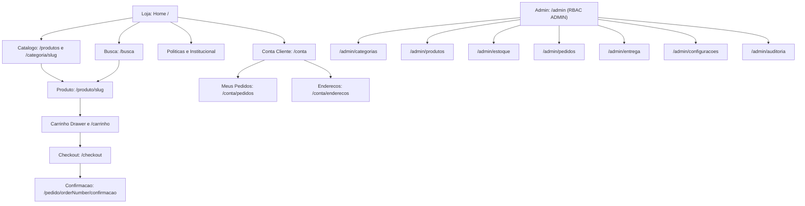

# 06 — UX, Arquitetura da Informação e Design System Agnóstico

Este documento define a arquitetura de rotas da loja e do painel administrativo, os fluxos mobile-first críticos para venda de vestuário, as especificações de acessibilidade (WCAG 2.2 AA), as diretrizes de SEO/Core Web Vitals e a fundação semântica de **Design System agnóstica de marca**, pronta para receber a identidade visual em `T02`.

---

## 1. Arquitetura da Informação e Sitemap



### Mapa Completo de Rotas

| Área | Rota | Tipo | Finalidade |
| --- | --- | --- | --- |
| **Loja Pública** | `/` | SSR/ISR | Vitrine inicial: banner editorial, categorias em destaque, novidades, diferenciais de entrega local e rodapé legal completo. |
| **Loja Pública** | `/produtos` e `/categoria/[slug]` | SSR/ISR | Listagem (PLP) com filtros por categoria/subcategoria, tamanho, cor, faixa de preço, disponibilidade e ordenação. |
| **Loja Pública** | `/busca` | Dinâmica | Resultados de busca por nome, descrição ou SKU com os mesmos controles de filtro. |
| **Loja Pública** | `/produto/[slug]` | Híbrida (ISR + estoque fresco) | PDP completa com galeria, matriz Cor×Tamanho, guia de medidas, simulador de entrega local e resumo de troca. |
| **Institucional** | `/politicas/trocas-e-devolucoes`, `/politicas/privacidade`, `/politicas/termos`, `/sobre`, `/contato` | ISR | Páginas alimentadas por `StorePolicy` e `StoreConfig` (obrigatórias pelo Decreto 7.962/2013 e CDC). |
| **Compra** | `/carrinho` | Dinâmica | Visão completa do carrinho (complementando o Cart Drawer lateral) e alertas de mudança de preço/estoque (`RN13`). |
| **Compra** | `/checkout` | Autenticada | Fluxo enxuto em etapas: Identificação → Entrega Local / Retirada → Pagamento Pix ou Cartão. |
| **Compra** | `/pedido/[orderNumber]/confirmacao` | Autenticada | Tela pós-checkout com QR Code Pix + Copia e Cola + contador da reserva ou confirmação imediata de cartão. |
| **Conta Cliente** | `/login`, `/cadastro`, `/recuperar-senha` | Pública | Autenticação segura com redirecionamento de retorno ao checkout e merge automático de carrinho. |
| **Conta Cliente** | `/conta`, `/conta/pedidos`, `/conta/pedidos/[id]`, `/conta/enderecos` | Autenticada | Histórico de pedidos com timeline de status, reexibição de Pix válido e gestão de endereços. |
| **Admin** | `/admin`, `/admin/produtos`, `/admin/produtos/novo`, `/admin/produtos/[id]` | `ADMIN` | Cadastro manual completo, upload Cloudinary, gerador de matriz de variantes e arquivamento. |
| **Admin** | `/admin/categorias`, `/admin/estoque` | `ADMIN` | Árvore de categorias e ajuste rápido de estoque com motivo obrigatório. |
| **Admin** | `/admin/pedidos`, `/admin/pedidos/[id]` | `ADMIN` | Gestão operacional de pedidos, aprovação/preparo/despacho/entrega e tratamento de exceções. |
| **Admin** | `/admin/entrega`, `/admin/configuracoes`, `/admin/auditoria` | `ADMIN` | Zonas de entrega local (`DeliveryZone`), parâmetros de `StoreConfig`/`StorePolicy` e trilha `AuditLog`. |

---

## 2. Anatomia das Telas Críticas (Mobile-First)

### 2.1. Cabeçalho e Navegação
- **Mobile (< 768px):** Botão hambúrguer (gaveta com categorias/subcategorias e acesso rápido à conta), logo centralizada, lupa de busca expansível e ícone da sacola com badge numérico ao vivo.
- **Desktop:** Barra superior limpa com logo, categorias principais, campo de busca visível, ícone de conta e sacola.
- **Aviso de cobertura local:** Barra discreta no topo ou selo institucional informando a cidade atendida (`StoreConfig.primaryCity`) e política de retirada (quando ativa).

### 2.2. Card de Produto e Grade de Catálogo (PLP)
- **Proporção de imagem:** Padrão vertical **3:4** ou **4:5** (`aspect-[3/4]`) com `object-cover` para manter alinhamento uniforme de peças de roupa sem cortes indesejados.
- **Conteúdo do Card:**
  1. Imagem principal + troca suave no hover (desktop) para segunda foto quando existir;
  2. Badge discreta apenas quando relevante (`Esgotado` ou `Últimas unidades`);
  3. Bolinhas de cores disponíveis (`colorHex` de `ProductOptionValue`) limitadas a 4–5 com indicador `+N`;
  4. Nome do produto (máx. 2 linhas) e preço em destaque (com preço riscado se `compareAtPriceCents > priceCents`).
- **Filtros Mobile:** Botão fixo *"Filtrar e Ordenar"* abrindo bottom-sheet/drawer com chips táteis de tamanho, cor, faixa de preço e toggle *"Somente disponíveis"*, evitando rolagem infinita antes de ver os produtos.

### 2.3. Página Individual do Produto (PDP) — Seletor Inteligente de Variações
- **Galeria:** Carrossel com swipe no mobile, miniaturas e zoom ao toque/clique; ao selecionar uma cor com imagens vinculadas (`ProductImage.optionValueId`), a galeria foca automaticamente nas fotos daquela cor.
- **Matriz Inteligente de Variantes (`CA04`, `CA05`):**
  - Se `hasVariants = false`: não exibe seletores desnecessários; exibe apenas disponibilidade e botão *"Adicionar à Sacola"*.
  - Se `hasVariants = true`: renderiza um `radiogroup` acessível para cada opção (`Cor`, `Tamanho`).
  - **Regra de disponibilidade cruzada:** Tomando o exemplo da v1.0 (Camiseta Básica Preta/Branca × P/M/G com `Branca + M = 0`):
    - Se nenhuma cor foi selecionada ainda, `M` permanece selecionável se existir estoque em `Preta + M`.
    - Ao selecionar `Branca`, o botão `M` recebe estado visual **indisponível/riscado** (`aria-disabled="true"` ou desabilitado com texto *"Tamanho M esgotado na cor Branca"*), mantendo `P` e `G` clicáveis normalmente.
  - Se o usuário clicar em *"Adicionar à Sacola"* antes de escolher todas as opções obrigatórias (`RN10`), destacar o grupo faltante com mensagem clara e foco acessível.
- **Apoio à decisão de moda:** Link/modal *"Guia de Medidas"* (vindo de `Product.sizeGuideMarkdown`), simulador rápido de entrega local por CEP e resumo da política de troca antes da compra.
- **Mobile Sticky CTA:** Barra inferior fixa no celular com preço e botão primário *"Adicionar à Sacola"* quando a dobra principal rolar para cima.

### 2.4. Drawer de Carrinho e Página `/carrinho`
- Exibe miniatura, nome, **rótulo da variação selecionada** (ex.: `Preta · Tam. M`), controle `+ / -` respeitando `availableStock`, remoção e subtotal parcial.
- **Alerta transparente (`RN13`):** Se um item teve alteração de preço ou redução de estoque desde a inclusão, exibir banner informativo no topo do carrinho destacando o ajuste antes de ir ao checkout.

### 2.5. Fluxo de Checkout Enxuto (`/checkout`)
1. **Identificação:** Se visitante clicar em finalizar, redirecionar para login/cadastro rápido com retorno automático para `/checkout` e merge imediato do carrinho (`RN30`).
2. **Entrega Local ou Retirada:**
   - Seleção de endereço salvo ou novo cadastro com busca opcional via ViaCEP.
   - Validação imediata via `POST /api/delivery/quote`: se fora da cobertura e retirada desabilitada, bloquear avanço com mensagem clara da área atendida (`CA12`).
   - Exibição transparente de taxa, prazo estimado e opção de retirada (se `storePickupEnabled = true`).
3. **Pagamento & Resumo Legal (Decreto 7.962/2013):**
   - Alternância limpa entre **Pix** (destacando agilidade na aprovação) e **Cartão** (campos hospedados/tokenizados pelo SDK do gateway — zero envio de dados de cartão ao backend).
   - Resumo final imutável de itens, subtotal, entrega, total e checkbox/nota visível com link para Política de Trocas e Devoluções.
4. **Confirmação (`/pedido/[orderNumber]/confirmacao`):**
   - Para **Pix:** QR Code grande, botão de um clique *"Copiar código Pix"* com feedback visual, e **contador regressivo** sincronizado com `pixExpiresAt` informando por quanto tempo as peças estão reservadas.
   - Para **Cartão:** confirmação de aprovação ou orientação clara em caso de recusa com opção de tentar outro meio enquanto o carrinho/pedido permite.

### 2.6. Painel Administrativo (`/admin`)
- Layout de produtividade (sidebar responsiva + tabelas claras com busca rápida).
- **Editor de Produto + Matriz:** Ao adicionar opções (`Cor`, `Tamanho`), o Admin gera automaticamente a grade de combinações com campos inline de SKU sugerido, preço e estoque inicial.
- **Gestão de Pedidos:** Filtros por aba de status (`Todos`, `Aguardando Pagamento`, `Pagos / Separar`, `Em Entrega / Retirada`, `Revisão Manual`), botão contextual para o próximo passo válido da máquina de estados e visualização imediata do histórico de status.

---

## 3. Fundação de Design System Agnóstico de Marca (`T02`)

Como a identidade visual será criada do zero em `T02` após o briefing com o cliente ([01-APROVACAO-COMERCIAL-CLIENTE.md](./01-APROVACAO-COMERCIAL-CLIENTE.md)), os componentes de frontend devem consumir **exclusivamente tokens semânticos** (CSS Custom Properties mapeadas no Tailwind), nunca cores hexadecimais fixas nos componentes.

### 3.1. Contrato Base de Tokens Semânticos (`globals.css`)

```css
:root {
  /* Superficies e Bordas (substituidos pela identidade visual em T02) */
  --surface-page: #ffffff;
  --surface-subtle: #f7f7f5;
  --surface-card: #ffffff;
  --border-default: #e5e5e0;
  --border-strong: #1c1917;

  /* Tipografia */
  --text-primary: #171717;
  --text-secondary: #525252;
  --text-muted: #737373;
  --text-inverse: #ffffff;

  /* Marca (valores provisorios neutros ate T02) */
  --brand-primary: #171717;
  --brand-primary-hover: #2e2e2e;
  --brand-accent: #854d0e;

  /* Estados Semânticos (fixos de usabilidade) */
  --status-success-bg: #dcfce7;
  --status-success-fg: #166534;
  --status-warning-bg: #fef3c7;
  --status-warning-fg: #92400e;
  --status-danger-bg: #fee2e2;
  --status-danger-fg: #991b1b;
  --status-info-bg: #dbeafe;
  --status-info-fg: #1e40af;

  /* Tipografia, Raios e Espacamento */
  --font-display: var(--font-sans);
  --font-body: var(--font-sans);
  --radius-sm: 0.25rem;
  --radius-md: 0.5rem;
  --radius-lg: 0.75rem;
  --radius-pill: 9999px;
}
```

### 3.2. Padrão de Badges Semânticos (`OrderStatus` e Estoque)

| Contexto | Estado | Visual Semântico |
| --- | --- | --- |
| **Estoque** | Disponível (`> 3`) / Baixo (`1–3`) / Esgotado (`0`) | Neutro ou Verde (`Disponível`) · Âmbar (`Últimas X un.`) · Vermelho/Cinza riscado (`Esgotado`) |
| **Pedido** | `AWAITING_PAYMENT` | Âmbar (`--status-warning-*`) |
| **Pedido** | `PAID`, `PREPARING`, `OUT_FOR_DELIVERY`, `READY_FOR_PICKUP` | Azul/Info (`--status-info-*`) |
| **Pedido** | `DELIVERED` | Verde (`--status-success-*`) |
| **Pedido** | `CANCELLED`, `EXPIRED`, `REFUNDED` | Vermelho/Neutro (`--status-danger-*`) |

### 3.3. Checklist Obrigatório de Estados de UI
Toda tela ou módulo interativo deve implementar explicitamente:
1. **Loading:** Skeletons com mesma proporção do card/tabela para zerar layout shift (CLS).
2. **Empty State:** Mensagens claras com CTA de ação (ex.: busca sem resultado sugerindo limpar filtros ou voltar ao catálogo; sacola vazia com link para lançamentos).
3. **Inline Validation:** Mensagens objetivas abaixo dos campos de formulário (CEP, senha, variação não selecionada).
4. **Error Fallback:** Tratamento amigável caso o gateway ou rede falhe, preservando dados já preenchidos pelo cliente.

---

## 4. Acessibilidade (WCAG 2.2 AA) e SEO Técnico

### 4.1. Requisitos Obrigatórios de Acessibilidade
- **Contraste:** Mínimo **4,5:1** para texto normal e **3:1** para texto grande, ícones funcionais e bordas de campos/botões ativos.
- **Navegação por Teclado:** Todos os fluxos (menu, filtros, seletor de cor/tamanho via `role="radiogroup"` e setas/Enter, drawer de carrinho, checkout) operáveis sem mouse, com anel de foco (`:focus-visible`) visível.
- **Alvos de Toque:** Botões de tamanho, swatches de cor, controles `+ / -` e ações no mobile com área mínima clicável de **44×44px**.
- **Leitores de Tela:** `alt` descritivo em todas as fotos de produto (`ProductImage.altText`), regiões `aria-live="polite"` ao atualizar carrinho/preço/disponibilidade e labels explícitos em todos os inputs.
- **Movimento Reduzido:** Respeitar `@media (prefers-reduced-motion: reduce)` em animações de drawers, transições e carrosséis.

### 4.2. SEO Técnico e Core Web Vitals
- **Metadados Dinâmicos (`generateMetadata`):** Título e descrição únicos por categoria e produto, com tags **OpenGraph** e Twitter usando a imagem primária do produto (para pré-visualização rica ao compartilhar links no WhatsApp e Instagram).
- **Dados Estruturados (JSON-LD Schema.org):** Injetar schema `Product` + `Offer` em `/produto/[slug]` contendo nome, imagens, SKU, `priceCurrency: "BRL"`, preço formatado e `availability` (`InStock` / `OutOfStock`).
- **Indexação Limpa:** `app/sitemap.ts` dinâmico listando home, categorias ativas, produtos `ACTIVE` e políticas; `app/robots.ts` bloqueando `/admin`, `/api`, `/conta`, `/checkout` e `/carrinho`; URLs canônicas em PLPs filtradas para evitar conteúdo duplicado.
- **Otimização de Imagens:** Sempre usar `next/image` com `sizes` responsivos, prioridade (`priority`) na imagem principal acima da dobra da PDP e entrega `f_auto,q_auto` do Cloudinary.
